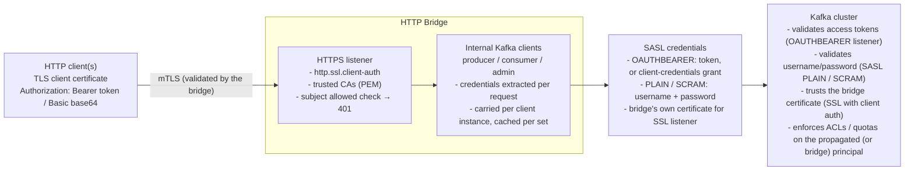

# Design: HTTP Bridge authentication (OIDC, Basic, TLS client certificate)

This document is a design sketch for the authentication methods supported by the Strimzi HTTP Bridge,
including the required changes in the `KafkaBridge` custom resource (CRD) in the
[Strimzi Kafka Operator](https://github.com/strimzi/strimzi-kafka-operator) repository.

Three authentication methods are covered:

* **OIDC access token authentication** (`authentication.type=oauth`): HTTP clients provide an OIDC
  access token (Bearer scheme), either passed through to the Kafka cluster or obtained by the bridge
  itself via the client credentials grant.
* **HTTP Basic authentication** (`authentication.type=basic`): HTTP clients provide a username and
  password (Basic scheme) passed through to the Kafka cluster.
* **TLS client certificate authentication** (`authentication.type=client-cert`): HTTP clients
  authenticate to the bridge itself via a client certificate presented during the TLS handshake.

## Problem statement

The Strimzi HTTP Bridge lets HTTP clients use Kafka without the native Kafka protocol, but until now
it could only work against completely unsecured Kafka clusters - and the HTTP interface itself had no
authentication at all.

Broken down, the gaps were:

### 1. No way to use the bridge against a secured Kafka cluster

Real-world Kafka clusters run with SASL (SCRAM, PLAIN) or OAUTHBEARER listeners and TLS. The bridge's
internal Kafka clients (producer, consumer, admin) had no way to obtain or carry credentials, so any
deployment requiring an authenticated cluster simply couldn't use the bridge.

### 2. No end-to-end identity propagation (multi-tenant authorization)

When multiple HTTP clients share one bridge, all of them hit Kafka with the *bridge's* identity. The
broker cannot enforce per-client ACLs, audit trails show the bridge instead of the real caller, and
quota/authorization policies can't distinguish clients. Enterprises standardizing on OIDC (Keycloak,
etc.) want the *caller's* access token to reach the broker so Kafka itself authorizes the original
identity - OAuth2/OIDC passthrough.

### 3. No support for the most common credential mechanism

HTTP Basic is the simplest, most widely implemented credential scheme for HTTP clients - and it was
unsupported, blocking straightforward integration of existing HTTP tooling with SASL-secured clusters.

### 4. The bridge's HTTP interface itself is unauthenticated and unattributable

Anyone who can reach the bridge's port can produce to or consume from any topic. There was no built-in
mechanism to authenticate the client *to the bridge* - no mTLS client-certificate support, no way to
restrict which certificates/subjects are accepted. Network-level controls (firewalls, reverse proxies)
were the only option.

### Underlying constraints that shape the solution

* **Kafka clients are long-lived**: a SASL/TLS connection authenticates once, not per request - so
  "true per-request authentication" is impossible with Kafka clients as-is; the bridge must define
  pragmatic credential semantics (producer recreated on credential change, consumer bound at creation
  with an optional same-principal refresh when the pinned token expires, admin cached per credential).
* **Secrets must never leak**: tokens and passwords must be masked in logs and `toString()`.
* **The bridge never validates what Kafka can validate**: the broker owns token/credential validation;
  the bridge only transports credentials (except TLS client certs, which terminate at the bridge and
  therefore *are* validated there).
* **Add the least amount of new dependencies and leverage what is already used**: new functionality is
  delegated to libraries already on the classpath wherever possible - JWT/JWK parsing, thumbprints and
  the JWKS retrieval chain to nimbus-jose-jwt, the DPoP replay cache to Guava, claim/discovery field
  extraction to Jackson - instead of hand-rolling crypto/JSON/parsing code or introducing additional
  libraries (a new direct dependency is added only when nothing existing covers the need, as with the
  nimbus OAuth 2.0 SDK for the RFC 8414 discovery document parsing).

In one sentence: enable the HTTP Bridge to participate in secured Kafka deployments - by
authenticating the bridge's Kafka connections, propagating the HTTP client's identity to Kafka
(OAuth/Basic), and authenticating HTTP clients to the bridge itself (TLS client certificates) -
without weakening Kafka's own authorization model.

## Solution (high level)

The solution extends the HTTP Bridge with three configurable, composable authentication methods, all
driven by a single `authentication.*` configuration namespace in `application.properties`, and splits
responsibility cleanly along one principle: **the bridge transports credentials, Kafka validates them -
except TLS client certificates, which terminate at the bridge and are validated there.**



### 1. Credential passthrough to Kafka (OAuth + Basic)

* HTTP clients present credentials in the standard `Authorization` header (`Bearer <token>` or
  `Basic <base64>`).
* The bridge extracts them per request, carries them as immutable `AuthCredentials` objects through the
  `RoutingContext` (no `ThreadLocal`, secrets masked in `toString()`), and injects them into the
  internal Kafka clients' configuration as SASL credentials (`OAUTHBEARER` via a custom login callback
  handler, or `PLAIN`/`SCRAM` via the login modules).
* Because Kafka clients are long-lived, the bridge defines pragmatic semantics: producers are recreated
  when credentials change on a connection, consumers are bound to the credentials of the request that
  created them (with the opt-in consumer credentials refresh replacing an expired pinned token with a
  valid same-principal token, see [Consumer credentials refresh](#consumer-credentials-refresh)), and
  admin clients are cached per credential set.
* For OAuth there is a second mode (`client-credentials`) where the bridge obtains and refreshes tokens
  itself from the OIDC token endpoint - for deployments where per-client identity is not needed but the
  cluster requires OAuth.

### 2. TLS client certificate authentication (bridge-level mTLS)

* The bridge's HTTPS listener gains `http.ssl.client-auth` (`none`/`request`/`required`) and
  trusted-CA configuration via Vert.x `ServerSSLOptions` - cert-less connections can be rejected at the
  handshake itself.
* A root handler validates the peer certificate's subject against configurable regular expression
  patterns (`authentication.allowed.subjects`) before any request is processed, rejecting with
  `401 Unauthorized` otherwise.
* This authenticates the client *to the bridge*; Kafka connections use the bridge's own certificate
  (shared principal). It also composes with OAuth/Basic for per-client Kafka identity on top of mTLS
  transport.

### 3. Single config surface, operator-friendly

* Everything is plain `application.properties` (`authentication.type`, `authentication.mode`,
  `http.ssl.*`, `kafka.*` passthrough), so the Kubernetes integration needs no bridge-side changes: the
  Strimzi operator generates the properties file. See the `KafkaBridge` CRD sketch below for the
  corresponding CRD evolution (an `oauth` authentication type; client-cert under `spec.http`).

### 4. Validation responsibilities

Split by the two trust boundaries the bridge terminates:

* *TLS layer - full validation, done by the bridge*: the bridge terminates the TLS handshake with HTTP
  clients, so it owns this validation entirely:
  * certificate chain validity, enforced by the TLS stack against the trusted certificates
    (`http.ssl.trusted.certificates(.location)`) at handshake time
  * client auth enforcement (`http.ssl.client-auth=required` rejects cert-less connections at the
    handshake itself)
  * subject-based authorization (`authentication.allowed.subjects` regular expression patterns,
    full-match against the certificate subject DN, checked before any request routing)
  * certificate expiry/validity period (handled automatically by the TLS stack during chain validation)
* *Authorization header - syntactic validation only*: for OAuth and Basic, the bridge validates only
  the shape of the credentials (header present and parseable, otherwise `401`). This is deliberately
  not cryptographic validation: the broker, which owns the credentials, does that.
* *Deliberately not validated by the bridge (by default)*: the JWT signature, issuer, audience and
  expiry (the broker's OAUTHBEARER listener validates the token) and the username/password correctness
  (the broker's SASL PLAIN/SCRAM listener validates them). Validating these at the bridge would
  duplicate trust decisions and require the bridge to hold validation material (JWKS keys, credential
  stores). For the JWT signature and claims, an optional token validation is available
  (`authentication.token.validation=jwks`), where the bridge verifies the token against the JWKS
  endpoint of the OIDC provider before forwarding it - a cheap pre-filter in front of the broker,
  which remains the authority.

Possible future extensions (not implemented), following the same patterns available as Kroxylicious
filters:

* *Bridge-level RBAC*: allow-lists mapping an authenticated identity (certificate subject, Basic
  username or OAuth principal claim) to permitted operations or topics
* *Per-identity quotas / rate limiting* at the bridge

The validation philosophy: validate what terminates at the bridge (TLS client certificates - chain and
subject), transport what terminates at the broker (tokens, passwords - shape only).

### In one sentence

Add standard credential transport (OAuth Bearer, Basic) from HTTP clients to the bridge's Kafka
connections with well-defined per-connection semantics, plus native mTLS with subject-based
authorization on the bridge's HTTPS listener - configured entirely through properties, validated by
the broker wherever the broker can validate.

## Alternatives considered

For the same problem (secure the bridge, and get per-client identity to Kafka), these are the credible
alternatives - and the trade-offs that made the implemented approach the better fit:

### 1. Header-based per-client certificate passthrough to Kafka

The bridge accepts each client's *certificate + private key* via HTTP headers and presents *that*
client's own certificate to Kafka - giving true per-client Kafka principals with zero extra auth code
(Kafka derives the principal from the certificate subject natively).

* Real per-client identity at the broker; ACLs, quotas and audit logging per client.
* Private keys travel through the bridge on every request - a serious security liability and unusual
  for HTTP clients that already use mTLS with the bridge.
* Kafka connection churn: each distinct client certificate forces producer/consumer recreation and a
  full TLS handshake.
* HTTP clients would have to manage X.509 key material, which is unusual for REST consumers.

### 2. SASL termination at the bridge (bridge as authenticator)

The bridge validates credentials *itself* (against the OIDC provider's introspection/JWKS endpoint or
an LDAP backend) and connects to Kafka with a single bridge service account.

* Works even against clusters the bridge cannot do per-client authentication with; centralizes
  validation; early rejection of bad credentials.
* Kafka sees only the bridge principal - per-client ACLs, quotas and audit at the broker are lost
  (authorization would have to move into the bridge).
* The bridge needs validation infrastructure (JWKS/LDAP access) and shares trust decisions with the
  broker.
* This is close to the existing `client-credentials` OAuth mode, kept as an option rather than the
  main path.

### 3. HTTP reverse proxy / API gateway in front of the bridge

Offload authentication to an OAuth2 proxy, Envoy or nginx + authentication layer, assuming the bridge
itself implements *no* authentication (no OAuth/Basic passthrough): the gateway becomes the only
authentication boundary, and the bridge is a transparent pass-through of already-authenticated traffic.

An API gateway is a legitimate solution for the *HTTP side*, but with no authentication implemented in
the bridge, several things must be done to make it secure, and significant capabilities remain
unsolved:

* *Gateway-side authentication*: the gateway must authenticate every client itself - TLS with client
  certificates (mTLS), OIDC token validation, or API keys - and terminate TLS on the client-facing
  side.
* *Identity injection is lost downstream*: the gateway can inject the authenticated identity into
  forwarded headers (`X-Forwarded-User`, `X-SSL-Client-DN`, ...), but the bridge has no mechanism to
  consume them - the identity is ignored and cannot be propagated to Kafka. All requests reach the
  Kafka cluster with the *bridge's* single principal (e.g. a static service account configured via the
  `kafka.*` properties, or the bridge's own TLS certificate).
* *Network lockdown (non-negotiable)*: since authentication happens only at the gateway, the bridge
  must only accept traffic from the gateway - otherwise an attacker bypasses the gateway entirely and
  gets unauthenticated access to the bridge. Concretely: a network policy or firewall making the bridge
  port reachable only from the gateway (optionally plus a shared secret between gateway and bridge).
* *Coarse authorization only*: without the bridge propagating per-client credentials, the broker cannot
  enforce per-client ACLs, quotas or audit trails - everything is attributed to the bridge principal.
  Per-client authorization can only be approximated at the gateway with route/path rules (e.g. one
  route per topic per client), which is coarse, hard to maintain and does not understand Kafka
  semantics (partition-level operations, consumer groups, admin operations).
* *Endpoint routing hygiene*: only the API endpoints go through the gateway. The management endpoints
  (`/ready`, `/healthy`, `/metrics`) must stay reachable directly (Kubernetes probes do not carry
  authentication), so the gateway should not front them.
* *Operational burden*: deploy, operate and make highly available the gateway, rotate its certificates,
  configure routes for the full OpenAPI surface and monitor it. The deployment story becomes
  "gateway + bridge" instead of just "bridge".

An API gateway alone is therefore an *incomplete* solution when the bridge implements no
authentication: it secures the HTTP front, but identity attribution stops at the gateway, the Kafka
principal is a single shared one, and per-client authorization degrades to coarse gateway-level rules.
This is the main reason the bridge implements the authentication itself (OAuth, Basic and client-cert):
with the passthrough, a gateway can be *added* in front (forwarding the `Authorization` header
untouched) and everything keeps working - but the gateway is not a substitute for the bridge's
authentication.

#### Multiple Kafka clients in the API gateway scenario

Without the bridge's authentication, per-client Kafka identity can only be achieved by scaling out the
bridge instead of authenticating through it. The viable patterns are:

* *Single shared principal + coarse gateway rules*: all clients share the bridge's one principal, and
  the gateway enforces per-client access with route/path rules (e.g. API key A may only call
  `/topics/topic-a/...`). Simplest, but broker-side ACLs, quotas and audit trails all attribute to the
  bridge principal, and the gateway rules are coarse and do not understand Kafka semantics (partition
  operations, consumer groups, admin endpoints).
* *One bridge deployment per client/tenant (the realistic pattern)*: each bridge instance is configured
  with its *own* Kafka credentials via the `kafka.*` properties (its own service account SASL
  configuration, or its own TLS certificate), and the gateway routes each authenticated client to its
  dedicated bridge.
  ```mermaid
  flowchart LR
      A["Client A"]
      B["Client B"]
      C["Client C"]

      GW["API Gateway<br/>authN per client,<br/>route by client"]

      subgraph bridges["Bridge deployments (own Kafka credentials via kafka.* properties)"]
          BA["Bridge A"]
          BB["Bridge B"]
          BC["Bridge C"]
      end

      K["Kafka cluster<br/>per-tenant ACLs, quotas, audit trails"]

      A --> GW
      B --> GW
      C --> GW
      GW --> BA
      GW --> BB
      GW --> BC
      BA -- "principal A" --> K
      BB -- "principal B" --> K
      BC -- "principal C" --> K
  ```
  This gives real per-tenant principals at the broker (ACLs, quotas, audit trails work), blast-radius
  isolation (one client cannot exhaust the others' connections) and per-bridge configurations. It uses
  only pre-existing bridge capabilities (static `kafka.*` credential configuration). The trade-offs are
  more deployments and credentials to manage, and identity granularity is per-tenant, not per end user
  (multiple end users behind one bridge share that tenant's principal).
* *Passthrough (what the bridge implements)*: the gateway forwards the client's original
  `Authorization` header untouched, and the bridge propagates it to Kafka per client - producers,
  consumers and admin clients are keyed per credential set, so a single bridge deployment supports
  multiple Kafka clients natively. This is precisely the gap the implemented authentication closes.

  | Pattern | Per-client Kafka principal | Extra deployments | Needs bridge changes |
  |---|---|---|---|
  | Single shared principal + gateway rules | no | no | no |
  | One bridge deployment per client/tenant | yes (per tenant) | yes | no |
  | Passthrough (implemented) | yes | no | no (already implemented) |

### 4. Kafka delegation tokens per client

The bridge obtains Kafka *delegation tokens* per client and uses them as SASL credentials.

* Native Kafka mechanism, short-lived, revocable.
* Token issuance requires Kerberos or broker-side delegation-token authentication as the bootstrap
  mechanism - a heavy prerequisite rarely present in OIDC-based stacks.
* No OAuth integration; not how modern Kafka deployments authenticate.

### 5. Do nothing at the Kafka layer; network controls only

Rely on network policies/firewalls plus a single bridge principal (the `client-credentials` mode).

* Zero code.
* No defense in depth, no per-client authorization, no identity propagation - does not actually solve
  the problem for multi-tenant use.

### Comparison

| | Implemented (passthrough + client-cert) | 1 (cert headers) | 2 (SASL termination) | 3 (gateway) | 4 (delegation tokens) |
|---|---|---|---|---|---|
| Per-client Kafka identity | yes (OAuth/Basic) | yes | no | no | yes |
| No secrets in HTTP headers | yes | no | yes | yes | yes |
| Broker keeps validating | yes | yes | no | no (single bridge principal) | yes |
| No extra components | yes | yes | yes | no | partially |
| Standard client tooling | yes | no | yes | yes | no |

The implemented design gets per-client Kafka identity via standard HTTP auth headers (which the broker
still validates), adds mTLS and subject checks for the HTTP surface, and keeps every optional
hardening step (early JWT validation, RBAC) as a non-breaking future extension.

## Authentication Overview

### OIDC access token authentication

With OIDC access token passthrough, HTTP clients provide an OIDC access token in the `Authorization`
header of their requests using the Bearer scheme:

```
Authorization: Bearer <access_token>
```

The bridge uses the provided token as the OAUTHBEARER credential when connecting to the Kafka cluster.
The bridge does *not* validate the token: the Kafka cluster (configured with an OAUTHBEARER listener)
is responsible for validating it.

With the client credentials grant mode, the bridge obtains (and refreshes) the access tokens itself
from the configured token endpoint, using its own client id and secret. HTTP clients are not
authenticated per request: all requests share the bridge's token and principal.

Optionally, with the token validation enabled (`authentication.token.validation=jwks` or
`introspection`), the bridge validates the tokens provided by HTTP clients against the JWKS
endpoint (signature, expiry and not-before with a configurable clock skew, and optionally issuer
and audience) or the introspection endpoint (RFC 7662, results cached) of the OIDC provider before
forwarding them to the Kafka cluster; invalid or expired tokens are rejected with a `401` response
without contacting the Kafka cluster, which remains the authority for validating the tokens.
The endpoints are configured directly (`authentication.jwks.endpoint.uri` /
`authentication.introspection.endpoint.uri`) or resolved automatically from the OIDC discovery
document (`authentication.discovery.uri`, from the `jwks_uri`/`introspection_endpoint` fields).

With DPoP enabled (`authentication.dpop=true`, RFC 9449), the HTTP clients authenticate with the
DPoP scheme (`Authorization: DPoP <access_token>`) and provide a DPoP proof in the `DPoP` header:
a JWT signed with a client-owned private key (the public key is embedded in the proof header),
bound to the single HTTP request (`htm`/`htu` claims), with a limited lifetime (`iat` claim,
window = the configured clock skew) and a unique identifier (`jti` claim, replay-checked by the
bridge). The bridge validates the proof (signature with the embedded public key, claims, replay
cache) and, when the access token carries the confirmation claim (`cnf.jkt`), only accepts it when
the JWK thumbprint (RFC 7638) of the proof public key matches the claim (sender-constrained
token). The `cnf.jkt` claim is read from the token payload (JWKS mode) or from the introspection
response (`cnf.jkt` field, introspection mode). Rejected proofs are counted with the
`invalid-dpop-proof` reason. The DPoP enforcement requires the token validation to be enabled
(fail-fast at startup).

Because Kafka clients are long-lived, a SASL connection authenticates only once (re-authentication
happens only via `connections.max.reauth.ms`). True per-request authentication is therefore not
possible with Kafka clients as-is. The token semantics offered by the bridge are:

* **Producer** requests: the producer authenticates with the token provided in the first request of the
  HTTP connection. If a subsequent request on the same connection provides a different token, the
  internal producer is recreated with the new token.
* **Consumer** requests: the consumer authenticates with the token provided in the request that created
  it (`POST /consumers/{groupid}`). By default, the consumer keeps this token until it is deleted.
  With the consumer credentials refresh enabled (see
  [Consumer credentials refresh](#consumer-credentials-refresh)), an expired pinned token is replaced
  by a valid token of the same principal presented on a subsequent request.
* **Admin** requests: an admin client is created lazily and cached per access token (bounded cache
  with idle eviction, the evicted clients are closed).

#### Consumer credentials refresh

The consumer credential semantics above mean that with short-lived access tokens, a long-lived
consumer session outlives its token: the broker connections fail the (re-)authentication at the
token expiry and the consumer group falls into rebalancing with poll errors, until the consumer
instance is deleted and re-created with a fresh token (the long-run load-testing finding,
see the recommendations in `LOAD-TESTING.md`).

The opt-in `authentication.consumer.credentials.refresh` option (boolean, default `false`) changes
this behavior: when enabled **and** the token validation is configured (`jwks` or `introspection`),
a subsequent request on the same consumer instance presenting a valid token of the same principal
recreates the underlying Kafka consumer with the new credentials, preserving the subscription or
assignment state. The refresh conditions, checked on every consumer-scoped request (except create
and delete):

* the pinned (creation-time) token is expired, including the tolerated clock skew
  (`authentication.clock.skew.seconds`): while it is still valid, a different token does not
  trigger a recreation (the session is stable, no churn on every token rotation);
* the incoming token carries the same principal claim (e.g. `preferred_username`) as the pinned
  one, so a refreshed token of the same identity takes over the session (a different principal
  keeps the pinned credentials; use a new consumer instance for a different identity);
* the claims of both tokens are decodable (expiry and principal claim present).

The refresh is observable by the operators via the
`strimzi_bridge_auth_consumer_credentials_refreshes_total` counter (Micrometer
`strimzi.bridge.auth.consumer.credentials.refreshes`), as the recreation itself
appears on the cluster only as a consumer group rebalance.

The Authorization header remains optional on the subsequent operations of a consumer instance
(the consumer keeps its pinned credentials when it is absent); when provided, the credentials are
validated by the bridge (a 401 response is sent on failure) and considered for the refresh.

Both tokens were already validated by the bridge (at consumer creation and on the incoming
request), so the claims are read without signature validation for this internal decision. The
recreation closes the old consumer with a bounded close timeout (1 second: its credentials are
expired, the graceful leave or auto-commit cannot succeed) and re-subscribes or re-assigns the
partitions of the recreated consumer. Trade-offs to be aware of:

* the recreation triggers a group rebalance (once per token lifespan) and, on manually assigned
  partitions, the consumer position restarts from the configured `auto.offset.reset`;
* it requires the token validation, so that the bridge can establish the principal and the expiry
  of the tokens on claims it verified; with the token validation disabled, the consumers keep
  their creation-time credentials.

### HTTP Basic authentication

HTTP clients provide the credentials in the `Authorization` header using the Basic scheme:

```
Authorization: Basic <base64-encoded username:password>
```

The bridge uses the provided username and password as the SASL credential when connecting to the
Kafka cluster. The bridge does *not* validate the credentials: the Kafka cluster (configured with a
SASL PLAIN or SCRAM listener) is responsible for validating them.

The credential semantics are the same as for the OAuth passthrough (per connection for producers,
per consumer instance for consumers, cached per credentials for admin clients).

### TLS client certificate authentication

HTTP clients authenticate to the bridge itself by presenting a client certificate during the TLS
handshake with the bridge HTTPS listener (mTLS):

```
http.ssl.enable=true
http.ssl.client-auth=required
http.ssl.trusted.certificates.location=/path/to/ca.crt

authentication.type=client-cert
authentication.allowed.subjects=CN=my-user.*,O=my-org
```

The certificate is validated by the bridge against the configured trusted certificates (certification
authorities); the subject of the accepted certificates can be restricted by a list of regular
expression patterns matched against the subject distinguished name (full match against the RFC 2253
format, e.g. `CN=my-user,O=my-org`). When no pattern is configured, any certificate issued by a
trusted certification authority is accepted. Rejected clients get a `401 Unauthorized` response; with
`http.ssl.client-auth=required`, connections without a client certificate are already rejected during
the TLS handshake.

The certificate is validated once per TLS connection, before any request is processed. A TLS client
certificate authenticates the client *to the bridge* only: it cannot be forwarded to the Kafka
cluster (the bridge does not hold the client's private key), so the internal Kafka clients connect
using the bridge's own certificate. All HTTP clients share the same Kafka principal, and access
control at the Kafka cluster level is based on the bridge principal, not on the individual HTTP
clients.

This method also composes with the OAuth and Basic authentication: mTLS at the bridge (transport
security and client authentication) can be combined with per-client OAuth or Basic credentials
passed through to the Kafka cluster.

## Bridge implementation (this repository)

Implemented in `main` as of this design:

### Dependencies

Following the *add the least amount of new dependencies and leverage what is already used* design goal
(see the underlying constraints), the implementation delegates the JWT/JWK/caching mechanics to
existing or already-transitive libraries instead of hand-rolling them, adding only one new direct
dependency:

* `com.nimbusds:nimbus-jose-jwt` (10.0.2) - *promoted from transitive to direct*: already pulled in
  transitively (via the Strimzi OAuth client and the Kafka clients), now declared explicitly since
  the implementation builds on its API surface. It provides:
  * JWT parsing (`JWTParser`/`JWTClaimsSet`) for the passthrough token claims (replacing hand-rolled
    compact-serialization splitting, Base64url decoding and claims extraction)
  * the JWK model, the RFC 7638 thumbprint computation and the signature verifiers
    (RSASSA/ECDSA, including RSASSA-PSS) for the DPoP proofs and the JWKS token validation
    (replacing hand-rolled JWK parsing, DER handling and thumbprint computation)
  * the JWKS retrieval chain (`URLBasedJWKSetSource` → `CachingJWKSetSource` →
    `OutageTolerantJWKSetSource`, wrapped in bridge-internal metered and HTTP-client-aware sources)
    for the caching, periodic refresh and outage tolerance of the provider keys (replacing the
    hand-rolled JWKS cache and its refresh/eviction logic)
* `com.nimbusds:oauth2-oidc-sdk` (11.26) - *new direct dependency*: the only addition. Used
  exclusively for the RFC 8414 discovery document parsing (`AuthorizationServerMetadata`, providing
  the `jwks_uri` field). The version is aligned with the nimbus-jose-jwt version (11.26 depends on
  exactly 10.0.2), so no version drift. It pulls in small transitive dependencies
  (`content-type`, `lang-tag`, `json-smart`) which remain an implementation detail of the SDK: the
  bridge code only touches the nimbus wrapper classes. Note that the SDK does not model the
  `introspection_endpoint` metadata field, so the discovery of that endpoint stays with Jackson
  (see below)
* `com.google.guava:guava` (33.7.2-jre) - *unchanged*: already a direct dependency (for the `jre`
  vs `android` artifact choice). Reused for the DPoP proof replay cache (`Cache` with
  `expireAfterWrite(iat window)` + `maximumSize`), replacing the hand-rolled bounded map with
  manual purge-on-overflow logic
* `com.fasterxml.jackson.*` (Jackson) - *unchanged*: already used by the bridge. Handles the claim
  checks on the token payload, the introspection responses and the `introspection_endpoint` field
  of the discovery document

The net effect is one new dependency (plus its small transitive jars) in exchange for replacing
several hundred lines of hand-rolled JWT/JWK/parsing/caching code with well-tested library
implementations.

### Common

* `config/AuthenticationConfig` - new `authentication.` configuration:
  * `authentication.type=oauth|basic|client-cert` enables the OIDC access token authentication, the
  HTTP Basic authentication or the TLS client certificate authentication
  * `authentication.mode=passthrough|client-credentials` (default `passthrough`, OAuth only) - mode
  for obtaining the access tokens
  * OAuth passthrough mode: `authentication.username.claim` (default `sub`) - JWT claim for mapping
  the token to the principal
  * OAuth passthrough mode with token validation (optional): `authentication.token.validation`
  (`none` (default) | `jwks` | `introspection`), `authentication.jwks.endpoint.uri`,
  `authentication.introspection.endpoint.uri`, `authentication.discovery.uri`
  (resolves the JWKS/introspection endpoints from the discovery document),
  `authentication.jwks.refresh.seconds` (default 300), `authentication.introspection.cache.seconds`
  (default 30), optional `authentication.valid.issuer.uri` / `authentication.expected.audience`,
  optional `authentication.clock.skew.seconds` (default 30, tolerated on the `exp`/`nbf` claims),
  and optional `authentication.http.timeout.seconds` (default 10, HTTP connections to the provider)
  * OAuth passthrough mode with token validation, optional
  `authentication.consumer.credentials.refresh` (default `false`) - recreates a consumer whose
  pinned (creation-time) token expired with a valid token of the same principal presented on a
  subsequent request (see [Consumer credentials refresh](#consumer-credentials-refresh))
  * OIDC provider connection (optional): `authentication.jwks.trusted.certificates(.location)`
  (trusted CA certificates, PEM), `authentication.jwks.client.certificate(.location)` +
  `authentication.jwks.client.key(.location)` (mTLS client certificate and PKCS#8 private key, PEM),
  and `authentication.proxy.host`/`port`/`username`/`password` (proxy for the HTTP connections
  to the provider endpoints)
  * OAuth client-credentials mode: `authentication.token.endpoint.uri`, `authentication.client.id`,
  `authentication.client.secret` (or `authentication.client.secret.location` for reading the secret
  from a file), and optional `authentication.scope` / `authentication.audience`
  * HTTP Basic authentication: optional `authentication.sasl.mechanism` (PLAIN, SCRAM-SHA-256 or
  SCRAM-SHA-512); if not set, the `kafka.sasl.mechanism` in the Kafka-related configuration is used,
  defaulting to `PLAIN`
  * TLS client certificate authentication: optional `authentication.allowed.subjects` - comma
  separated list of regular expression patterns for the subject of the accepted client certificates
* `auth/AuthCredentials` (interface), `auth/OidcAccessTokenCredentials`, `auth/BasicAuthCredentials` -
  credentials extracted from the `Authorization` header and carried to the Kafka clients
  (`equals`/`hashCode` for the admin client cache; passwords and tokens masked in `toString()`;
  `BasicAuthCredentials.fromBase64` decodes and validates the Basic scheme header value)
* `auth/SaslAuth` - dispatcher adding the authentication related properties to the Kafka client
  configuration, based on the configured authentication type and credentials
* `KafkaBridgeProducer`, `KafkaBridgeConsumer`, `KafkaBridgeAdmin` - `create()` overloads accepting the
  credentials; the authentication properties are added when OAuth or Basic authentication is enabled
  (the credentials are used in passthrough mode only)
* `HttpBridge` - extracts the `Authorization: Bearer <token>`, `Authorization: DPoP <token>` (with
  the DPoP proof validated and bound to the token, when DPoP is enabled) or
  `Authorization: Basic <base64>` header
  in passthrough mode only (401 when missing or invalid), validates the token when the token validation
  is configured (`auth/OidcTokenValidator`, 401 when invalid, before any Kafka work), fails fast at
  startup on a misconfigured token validation (`validateTokenValidation`) and on a misconfigured TLS
  context or proxy for the provider connections (the validator is created at startup, for both the
  JWKS and the introspection validation), stores the
  credentials in the `RoutingContext` data (per-request safe, no `ThreadLocal`), and recreates the
  connection's producer endpoint when the credentials change
* `HttpSourceBridgeEndpoint`, `HttpSinkBridgeEndpoint` - carry/pass the credentials at client creation
* `HttpAdminBridgeEndpoint` - in passthrough mode, admin clients created lazily and cached per
  credentials in a bounded cache (Guava, 100 entries, closed and evicted after 10 minutes without
  requests): without the bound, every distinct access token would accumulate a new admin client
  (with its connections and threads) for the whole bridge lifetime, since the tokens rotate by
  design; the evicted admin clients are closed and the evictions are counted
  (`strimzi.bridge.auth.cache.evictions{cache="admin"}`, with the cache entries gauge
  `strimzi.bridge.auth.cache.entries{cache="admin"}`); in client-credentials mode, a single shared admin client created at startup
* `src/main/resources/openapi.json` - the API reference documents the `Authorization` header
  (Bearer and Basic schemes)

### OIDC access token authentication

* `auth/OidcPassthroughToken` - `OAuthBearerToken` implementation built from the JWT payload
  (principal from the configured claim, lifetime from `exp`, optional `iat` and `scope`)
* `auth/OidcPassthroughLoginCallbackHandler` - SASL login callback handler returning the token coming
  from the HTTP request (provided per client instance via the `oauth.access.token` key in the Kafka
  client configuration) as the OAUTHBEARER token
* `auth/OidcTokenValidator` - validator for the OIDC access tokens (optional, with the token
  validation configured): verifies the JWT signature (RS256/RS384/RS512, PS256/PS384/PS512,
  ES256/ES384/ES512, via the `JwtSignatureAlgorithms` mappings) against the JWKS endpoint of the
  OIDC provider (keys cached and refreshed periodically, endpoint URI configured directly or resolved
  from the OIDC discovery document) and the standard claims (expiry and not-before with a configurable
  clock skew, and optionally issuer and audience), before the token is forwarded to the Kafka cluster.
  With a DPoP proof provided (JWK thumbprint of the proof public key), the token confirmation claim
  (`cnf.jkt`, from the payload in JWKS mode or from the introspection response in introspection mode)
  must match it (sender-constrained tokens). The HTTP client for the provider endpoints is rebuilt
  when the configured TLS material files (trusted certificates, client certificate, client key) change,
  so that a certificate rotation does not require a bridge restart (a failed rebuild keeps the
  previous client; a successful rebuild closes the replaced client, releasing its connections and
  threads). The introspection results are cached per token in a bounded cache (Guava, 1,000 entries,
  expiring with the configured cache period; a non-positive cache period disables the caching).
  The validator is closed on the bridge shutdown (`HttpBridge.stop()`): shutdown of the background
  scheduler, release of the JWKS retrieval chain and of the HTTP client. Authentication metrics
  (Micrometer): JWKS refresh/discovery counters, introspection counter and duration timer,
  introspection cache hit/miss counter and entries gauge, JWT signature verification duration
  timer, unknown key id (`kid`) counter (a token with a `kid` matching no cached JWKS key: either
  the provider rotated the keys before the next refresh, or a forged token), number of the cached
  JWKS keys, introspection in-flight calls, seconds since the last successful interaction with
  each provider endpoint (`strimzi.bridge.auth.last.success{endpoint=jwks|introspection|discovery}`,
  for the alerting on a provider outage - the bridge fails closed) and cache evictions. The
  gauges are implemented in the `OidcTokenValidatorGauges` class. The
  introspection endpoint URI is configured directly or resolved from the discovery document as well
* `auth/DpopProofValidator` - validator for the DPoP (RFC 9449) proofs provided by the HTTP clients
  in the `DPoP` header: the proof JWT (typ `dpop+jwt`) is verified with the public key embedded in
  the `jwk` header claim (no private key material accepted, only the supported asymmetric algorithms),
  the `htm`/`htu` claims must match the HTTP method and target URI of the request (absolute URI
  without query), the `iat` claim must be within the configured clock skew window and the `jti`
  claim is checked against a replay cache (bounded, with entries expiring with the `iat` window and
  the eviction delegated to Guava). Returns the JWK thumbprint
  (RFC 7638, base64url encoded SHA-256 digest over the canonical JSON of the required RSA/EC members)
  of the proof public key, for the binding check in the `OidcTokenValidator`. Metrics (Micrometer):
  the validation outcome counter with the granular reasons (`strimzi.bridge.auth.dpop{result}`:
  `valid`, `malformed`, `invalid-typ`, `unsupported-alg`, `missing-jwk`, `symmetric-key`,
  `private-key`, `bad-signature`, `htm-mismatch`, `htu-mismatch`, `invalid-iat`, `expired`,
  `missing-jti`, `replayed` - the `replayed` outcome is the security-relevant replay attack
  indicator), the replay cache entries gauge and the cache evictions counter
* `auth/JwtSignatureAlgorithms` - mappings of the supported JWT signature algorithms (RS*/PS*/ES*
  families) to the Java Signature algorithm names, the RSASSA-PSS parameters and the EC curves
* `auth/ProviderHttpClientFactory` - factory for the HTTP client connecting to the OIDC provider
  endpoints (JWKS, introspection, discovery): TLS trust store from the trusted certificates
  (`authentication.jwks.trusted.certificates(.location)`), mTLS client certificate and key
  (`authentication.jwks.client.certificate(.location)` + `authentication.jwks.client.key(.location)`,
  PEM cert + PKCS#8 key), and the proxy (`authentication.proxy.host`/`port`/`username`/`password`);
  built in the `OidcTokenValidator` constructor with the configured HTTP timeout (and rebuilt when
  the configured TLS material files change); a
  misconfigured TLS context or proxy fails fast (the bridge startup fails), instead of silently
  falling back to the default JVM trust store or to direct connections
* `auth/OidcAuth` - injects the OAUTHBEARER related properties into the Kafka client configuration,
  depending on the configured mode:
  * passthrough mode: placeholder `sasl.jaas.config`, `sasl.login.callback.handler.class` (passthrough
  handler), `oauth.access.token`, `oauth.username.claim`, preserving any user-provided values
  * client-credentials mode: `sasl.jaas.config` built inline with the client credentials options
  (`oauth.token.endpoint.uri`, `oauth.client.id`, `oauth.client.secret`, optional `oauth.scope`,
  `oauth.audience`, `oauth.username.claim`) and the Strimzi OAuth client
  `JaasClientOauthLoginCallbackHandler` as the login callback handler, which obtains and refreshes
  the tokens by itself
* Unit tests: `src/test/java/io/strimzi/kafka/bridge/auth/OidcAuthTest.java`,
  `src/test/java/io/strimzi/kafka/bridge/auth/OidcTokenValidatorTest.java` (JWT signature and claims
  validation against a local JWKS endpoint; JWKS/introspection/discovery failure modes with the
  fail-closed behavior and the failure metrics; JWKS key rotation (cache period) and unknown kid;
  provider mTLS handshake against a local HTTPS JWKS endpoint requiring a client certificate -
  `MtlsJwksTestServer` - covering the presented, rejected-subject, missing and untrusted-trust cases;
  authenticated proxy against a local proxy requiring Basic proxy authentication -
  `ProxyTestServer` - covering the successful and rejected credentials cases; trusted certificates,
  client certificate/key and proxy configuration; DPoP binding of the `cnf.jkt` confirmation claim
  in both the JWKS and the introspection modes (match, mismatch, missing proof); dynamic reload of
  the provider TLS materials (rotation to an allowed and to a rejected certificate, failed rebuild
  keeping the previous client); `toString()` secret masking; the authentication metrics
  (signature verification duration, unknown `kid`, JWKS keys count, last successful provider
  interaction per endpoint, introspection cache hit/miss and entries, in-flight introspection
  calls, cache evictions, DPoP validation outcomes with the granular reasons)),
  `src/test/java/io/strimzi/kafka/bridge/auth/DpopProofValidatorTest.java` (valid RSA and EC proofs
  with the returned RFC 7638 thumbprint, including the RFC 7638 example key vector; wrong `htm`/`htu`;
  missing, old and future `iat`; missing `jti`; replayed proof; wrong `typ`; private JWK member;
  `alg=none`; tampered payload; non-JWT input),
  `src/test/java/io/strimzi/kafka/bridge/auth/DpopProofsTestUtility.java` (DPoP proof builder for
  the integration tests)
* Integration tests: `src/test/java/io/strimzi/kafka/bridge/http/auth/OidcPassthroughIT.java`
  (passthrough against a Keycloak-backed OAUTHBEARER listener),
  `src/test/java/io/strimzi/kafka/bridge/http/auth/OidcClientCredentialsIT.java` (client-credentials
  mode: the bridge obtains its own tokens from Keycloak, no Authorization header needed and
  client-provided headers ignored),
  `src/test/java/io/strimzi/kafka/bridge/http/auth/OidcTokenValidationIT.java` (token validation
  enabled, against the Keycloak JWKS endpoint with the expected issuer),
  `src/test/java/io/strimzi/kafka/bridge/http/auth/OidcTokenIntrospectionIT.java` (token validation
  against the Keycloak introspection endpoint, including a token revoked at the provider via the
  RFC 7009 revocation endpoint - accepted until the cached introspection verdict expires, rejected
  afterwards) and
  `src/test/java/io/strimzi/kafka/bridge/http/auth/OidcTokenDiscoveryIT.java` /
  `OidcTokenIntrospectionDiscoveryIT.java` (endpoints resolved from the discovery document),
  `src/test/java/io/strimzi/kafka/bridge/http/auth/OidcTlsListenerIT.java` (token validation over
  the HTTPS listener, with the test-CA-signed server certificate), `OidcPassthroughIT`
  (alternating tokens on the same connection, exercising the per-credentials Kafka client caching)
  and `src/test/java/io/strimzi/kafka/bridge/http/auth/OidcDpopIT.java` (DPoP sender-constrained
  tokens: valid proof accepted, tampered proof, replayed proof and missing proof rejected with the
  `invalid-dpop-proof` rejected authentications metric);
  the ITs also assert the rejected authentications counter on the `/metrics` endpoint
  (`assertRejectedAuthMetric` in `AbstractIT`, with the `invalid-token`,
  `invalid-authorization-header` and `subject-not-allowed` reasons)

### HTTP Basic authentication

* `auth/BasicAuth` - injects the SASL related properties (PlainLoginModule or ScramLoginModule JAAS
  configuration with the username and password, `sasl.mechanism`) for authenticating the Kafka clients
  with the credentials coming from the HTTP requests

### TLS client certificate authentication

* `http/HttpConfig` - new HTTPS listener configuration:
  * `http.ssl.client-auth` (`none` (default) | `request` | `required`) - TLS client authentication mode
  * `http.ssl.trusted.certificates` / `http.ssl.trusted.certificates.location` - trusted certificates
  (PEM) for validating the client certificates
* `http/HttpBridge` - `serverSSLOptions()` applies the client authentication mode
  (`ServerSSLOptions.setClientAuth`) and the trusted certificates (`PemTrustOptions`); the
  `checkClientCert` root handler on the API router extracts the peer certificate from the TLS session,
  matches its subject against the allowed subjects patterns and rejects the request with
  `401 Unauthorized` ("Client certificate not provided" / "Client certificate subject not allowed")
* `http/auth/ClientCertAuth` - `isSubjectAllowed(subject, patterns)` utility matching the subject
  distinguished name against the allowed subjects patterns (full match semantics)
* Unit tests: `src/test/java/io/strimzi/kafka/bridge/http/auth/ClientCertAuthTest.java`
* Integration test: `src/test/java/io/strimzi/kafka/bridge/http/auth/ClientCertAuthIT.java` - Kafka
  cluster with an SSL listener requiring client authentication (trusting the bridge certificate), the
  bridge with an mTLS HTTPS listener, and HTTP clients presenting certificates with allowed/disallowed
  subjects and an expired certificate (allowed subject, but validity period in the past - rejected by
  the TLS stack during the handshake, proving that the certificate validity period is enforced);
  the certificate material is included in `src/test/resources/certs/` (regeneratable with the
  `generate.sh` script in the same folder) and the
  `BrokerFile`/`KafkaExtension` test support for copying files into the broker containers

### Test coverage

The authentication code (`io.strimzi.kafka.bridge.auth` package) is covered by unit tests and
integration tests, measured together with JaCoCo:

* **Unit tests** (169 in total, JUnit): JWT signature and claims validation, DPoP proof validation,
  discovery/introspection/JWKS failure modes, provider TLS (mTLS handshake, trusted certificates,
  client certificate/key), authenticated proxy, TLS material reload, header extraction, credential
  handling and `toString()` secret masking - all against local test servers (`HttpServer`-based JWKS,
  discovery, introspection, mTLS and proxy endpoints), so the failure modes are reproducible
  deterministically; the consumer credentials refresh decision
  (`HttpSinkBridgeEndpointTest`, `OidcAccessTokenCredentialsTest`) and the access-token claim
  extraction are covered on synthetic JWTs
* **Integration tests** (49 tests in 11 classes): end-to-end against Keycloak-backed Kafka clusters
  (`OidcPassthroughIT`, `OidcClientCredentialsIT`, `OidcTokenValidationIT`,
  `OidcTokenIntrospectionIT`, `OidcTokenDiscoveryIT`, `OidcTokenIntrospectionDiscoveryIT`,
  `OidcDpopIT`, `OidcTlsListenerIT`, `OidcConsumerCredentialsRefreshIT`) and against
  SASL/SSL-secured clusters (`BasicAuthIT`, `ClientCertAuthIT`), including the
  rejected-authentications metrics assertions; `OidcConsumerCredentialsRefreshIT` exercises the
  consumer credentials refresh end-to-end (short-lived realm tokens, the consumer keeps consuming
  after the pinned one expired) and `OidcPassthroughIT` pins the default behavior with the refresh
  disabled (records sent after the pinned token expired are never delivered to the consumer)

Known coverage limits of the integration tests: the consumer credentials refresh is exercised with
the `jwks` validation mode only (the `introspection` mode shares the same decision path, which is
unit-tested on the refresh conditions), and the combination of the refresh with the DPoP
sender-constrained tokens is not exercised end-to-end (the DPoP credentials follow the same
`OidcAccessTokenCredentials` extraction and comparison path as the Bearer ones).

**Measurement**: JaCoCo 0.8.12 in offline-agent mode (`org.jacoco:org.jacoco.agent:0.8.12`, the
`-runtime` classifier jar from the local Maven repository), writing one shared execution data file.
The two test layers are instrumented differently, because they run in different JVMs:

* *Unit tests* run in a JVM forked by surefire, so the agent is passed via the surefire `argLine`
* *Integration tests* run with `forkCount=0` directly in the Maven JVM (the failsafe configuration
  of this repository), so the agent is passed via `MAVEN_OPTS` - an `argLine` setting has no effect
  there and is silently ignored

```bash
JACOCO_AGENT=~/.m2/repository/org/jacoco/org.jacoco.agent/0.8.12/org.jacoco.agent-0.8.12-runtime.jar

# 1. Unit tests (surefire forks a JVM → agent via argLine), appending to target/jacoco.exec
mvn test -DargLine="-javaagent:$JACOCO_AGENT=destfile=$PWD/target/jacoco.exec"

# 2. Integration tests (failsafe with forkCount=0 → agent via MAVEN_OPTS),
#    one IT class at a time, with the test containers cleaned up in between
for IT in OidcTokenDiscoveryIT OidcTokenValidationIT OidcDpopIT OidcPassthroughIT \
          OidcTokenIntrospectionDiscoveryIT OidcTokenIntrospectionIT OidcClientCredentialsIT \
          OidcConsumerCredentialsRefreshIT \
          BasicAuthIT ClientCertAuthIT OidcTlsListenerIT; do
  docker ps -aq | xargs -r docker rm -f
  RUN_WITH_ALL_KAFKA_VERSIONS=false \
  MAVEN_OPTS="-javaagent:$JACOCO_AGENT=destfile=$PWD/target/jacoco.exec" \
  mvn verify -Dit.test=$IT -Dsurefire.failIfNoSpecifiedTests=false \
      -Dskip.surefire.tests=true -Dcheckstyle.skip=true
done

# 3. Report (reads target/jacoco.exec → target/site/jacoco/, HTML and jacoco.xml)
mvn org.jacoco:jacoco-maven-plugin:0.8.12:report
```

Notes on the mechanics:

* The JaCoCo agent appends to the execution data file by default, so the unit test run and the ten
  integration test runs (each a separate Maven JVM) accumulate into the same `jacoco.exec`; the
  order does not matter
* `RUN_WITH_ALL_KAFKA_VERSIONS=false` runs each IT class against a single Kafka version instead of
  the full version matrix (the numbers do not depend on the Kafka version)
* The execution data is tied to the compiled class files by their bytecode checksum: after any code
  change, previously recorded data for the changed classes is discarded by the report (class ID
  mismatch) - so all instrumented test layers must be re-run after code changes before generating
  the report, otherwise the numbers silently reflect the old bytecode for those classes (run the
  unit tests without `clean`, or re-run them after the IT loop, so that all layers contribute)

The numbers below are the combined result:

| Scope | Instruction | Branch | Line |
|---|---|---|---|
| `auth` package (17 classes) | 97.3% (3051/3137) | 92.1% (375/407) | 97.3% (748/769) |
| `OidcTokenValidator` | 97.6% (1451/1487) | 95.7% (178/186) | — |
| `OidcTokenValidatorGauges` | 100% (158/158) | 95.5% (21/22) | — |
| `DpopProofValidator` | 89.5% (332/371) | 86.5% (45/52) | — |
| `OidcPassthroughToken` | 94.1% (177/188) | 68.2% (15/22) | — |

The deliberately uncovered code (86 instructions) is defensive error handling and
thread-related attribution, not behavior:

* **Scheduler lambdas** (`OidcTokenValidator`): the startup prefetch of the JWKS keys and of the
  introspection endpoint runs on background scheduler threads; JaCoCo does not reliably attribute
  these executions (the functionality itself is exercised by the tests waiting on the prefetched data)
* **Defensive catch blocks around third-party calls**: the interrupted-fetch and chain-build-failure
  catches in the JWKS retrieval chain (an interrupted in-flight HTTP fetch and a URL-to-source
  construction failure cannot be provoked with valid configuration - the construction is validated
  eagerly), and the `IOException` catch when closing the JWKS retrieval chain at bridge shutdown
  (`OidcTokenValidator.close()`, the chain is already closed at that point in practice)
* **Race-guard branches**: the double-checked-locking re-checks (JWKS source building, HTTP client
  rebuild, introspection cache access) and the scheduler prefetch condition are single-threaded
  uncontended in the tests, so one branch side stays unexercised
* **Unreachable defense-in-depth guards** (`DpopProofValidator`): the octet-symmetric-key and
  private-key JWK checks cannot be reached through proof parsing, because nimbus already rejects
  such proofs at parse time (kept deliberately as a guard against future parsing changes); the
  corresponding rejection reasons (`symmetric-key`, `private-key`) are metric tag values only
* **Corner branches in claim mapping** (`OidcPassthroughToken`): structured (non-scalar) principal
  claims, and the lenient `iat` re-parse branch where the `iat` claim *is* numeric (only reachable
  with a non-numeric `exp` and a numeric `iat` on the same token)
* **Thumbprint failure catch** (`DpopProofValidator`): the `JOSEException` catch when computing
  the JWK thumbprint of the proof key (the key is already validated as RSA/EC before)

The validator lifecycle (scheduler shutdown, JWKS chain and HTTP client release in
`OidcTokenValidator.close()`, wired into `HttpBridge.stop()`) is exercised by the integration tests
through the bridge shutdown between tests - every method of the package is covered (100% method
coverage). All behavior-relevant paths are covered, in particular the fail-closed failure modes
(fetch and parse failures of the JWKS/discovery/introspection endpoints reject tokens rather than
degrade authentication) and the success/failure metrics for every provider interaction.

**Token revocation** is covered in the introspection validation mode: a token reported as not
active by the provider (RFC 7662 `active=false`, the same verdict a revoked token gets) is
rejected, the inactive verdict is cached for the configured period, and the end-to-end behavior is
verified against Keycloak (`OidcTokenIntrospectionIT`, unknown/invalid token rejected with `401`).
The realistic revocation flow is covered as well (`OidcTokenIntrospectionIT.sendWithRevokedToken`):
a token obtained from Keycloak is accepted, then revoked via the RFC 7009 revocation endpoint of
the provider, and the bridge keeps accepting it only until the cached active verdict expires (cache
period of 1 second in the test) and rejects it with `401` afterwards (with the rejected
authentications metric counted). For the certificates, the enforcement of the validity period by
the TLS stack is pinned as well (`ClientCertAuthIT.sendWithExpiredClientCertificate`): a client
certificate with an allowed subject but expired is rejected during the TLS handshake. The bridge
itself never calls the RFC 7009 revocation endpoint -
revocation happens at the provider, and the bridge detects it (within the introspection cache
period) only in the introspection mode: with the offline (`jwks`) mode, a revoked token remains
accepted until its `exp` (see the security considerations below).

### Documentation

* `documentation/modules/proc-configuring-http-bridge-oauth.adoc`
* `documentation/modules/proc-configuring-http-bridge-basic-auth.adoc`
* `documentation/modules/proc-configuring-http-bridge-client-cert.adoc`

Nothing else is needed in this repository for the Kubernetes integration: the operator generates the
`application.properties` file consumed by `bin/docker/kafka_bridge_run.sh`, and the bridge picks up the
`authentication.*` properties from it.

## `KafkaBridge` custom resource sketch (Strimzi Kafka Operator repository)

### Current state

The `KafkaBridge` CRD (`packaging/install/cluster-operator/046-Crd-kafkabridge.yaml`) supports only
`tls`, `scram-sha-256`, `scram-sha-512`, `plain`, and `custom` authentication types - there is no
`oauth` type (unlike `KafkaClientAuthenticationOAuth` used for Connect/MirrorMaker 2).

### OIDC access token authentication: CRD change

Add an `oauth` type to the `spec.authentication` section, following the existing
`KafkaClientAuthenticationOAuth` naming conventions:

```yaml
              authentication:
                type: object
                properties:
                  # ... existing properties (certificateAndKey, username, passwordSecret, sasl, config) ...
                  type:
                    type: string
                    enum:
                    - tls
                    - scram-sha-256
                    - scram-sha-512
                    - plain
                    - custom
                    - oauth                       # NEW
                    description: "Specifies the authentication type. ... `oauth` configures OIDC
                      access token authentication using the Strimzi OAuth client."
                  # NEW: oauth-specific fields
                  mode:                           # NEW
                    type: string
                    enum:
                    - passthrough
                    - client-credentials          # bridge-managed tokens
                    description: "Specifies how the bridge obtains OIDC access tokens.
                      `passthrough` forwards the access token provided by HTTP clients in the
                      Authorization header to the Kafka cluster. The Kafka cluster is responsible
                      for validating the tokens. Required with `type: oauth`."
                  usernameClaim:                  # NEW
                    type: string
                    description: "JWT claim to use as the identity of the access token. The default
                      is `sub`. Must match the `userNameClaim` configured on the Kafka cluster's
                      OAuth listener."
                  groupsClaim:                    # NEW (optional, matches listener option)
                    type: string
                x-kubernetes-validations:         # NEW: mutual exclusion rules
                - rule: "self.type != 'oauth' || has(self.mode)"
                  message: "mode property is required with type oauth"
                - rule: "self.type != 'oauth' || (!has(self.username) && !has(self.passwordSecret) &&
                    !has(self.certificateAndKey) && !has(self.sasl))"
                  message: "username, passwordSecret, certificateAndKey and sasl cannot be set
                    with type oauth"
                description: Authentication configuration for connecting to the cluster.
```

Adding an enum value and new optional properties is backward-compatible. The CEL validation rules
(`x-kubernetes-validations`) give users clear errors instead of misconfiguration at runtime.

#### Example custom resource

```yaml
apiVersion: kafka.strimzi.io/v1
kind: KafkaBridge
metadata:
  name: my-bridge
spec:
  replicas: 1
  bootstrapServers: my-cluster-kafka-bootstrap:9093
  tls:
    trustedCertificates:
      - secretName: my-cluster-cluster-ca-cert
        certificate: ca.crt
  authentication:
    type: oauth
    mode: passthrough
    usernameClaim: preferred_username   # must match the listener's userNameClaim
  http:
    port: 8080
```

#### Operator model changes

In `io.strimzi.operator.cluster.model.KafkaBridgeCluster` (operator repository), add the auth handling.
The operator writes the bridge's `application.properties` into a ConfigMap mounted at `custom-config/`,
so it is a pure properties mapping:

| CR field | Generated `application.properties` entry |
|---|---|
| `authentication.type: oauth` + `mode: passthrough` | `authentication.type=oauth` |
| `authentication.mode: client-credentials` | `authentication.mode=client-credentials` |
| `authentication.usernameClaim` | `authentication.username.claim=<claim>` (only when set) |
| `authentication.clientId` / `clientSecret` / `tokenEndpointUri` | `authentication.client.id` / `authentication.client.secret(.location)` / `authentication.token.endpoint.uri` |
| (always, for oauth) | `kafka.security.protocol=SASL_SSL` |
| (always, for oauth) | `kafka.sasl.mechanism=OAUTHBEARER` |
| `spec.tls` (optional) | existing `kafka.ssl.truststore.*` handling, unchanged |

### HTTP Basic authentication: CRD change

Covered by the existing `plain`, `scram-sha-256` and `scram-sha-512` authentication types (username +
`passwordSecret`): no CRD change is needed. The operator maps those types to
`authentication.type=basic` (+ optional `authentication.sasl.mechanism`) in the generated
`application.properties`, so the credentials provided by HTTP clients in the `Authorization` header
are passed through to the Kafka cluster.

### TLS client certificate authentication: CRD change

TLS client certificate authentication is TLS-level configuration of the HTTP listener rather than
Kafka client authentication, so it belongs in the `spec.http` section (and the existing
`spec.authentication` types remain unchanged for the Kafka connection):

```yaml
  http:
    port: 8080
    clientAuth: required                  # NEW: none (default) | request | required
    clientTrustedCertificates:            # NEW: CAs for validating the client certificates
      - secretName: my-client-ca
        certificate: ca.crt
    allowedSubjects:                      # NEW: regex patterns for the accepted certificate subjects
      - "CN=my-user.*"
```

The operator maps these to `http.ssl.client-auth`, `http.ssl.trusted.certificates.location` and
`authentication.allowed.subjects` in the generated `application.properties`. The Kafka connection
keeps using the bridge's own certificate via the existing `spec.tls` / `spec.authentication`
(`type: tls` with `certificateAndKey`) handling.

### Broker-side consistency

* *OAuth*: the `Kafka` CR's listener must be configured with `type: oauth` (with matching
  `userNameClaim` / `groupsClaim`, `validIssuerUri`, `jwksExpirySeconds`, etc.) since *the broker*
  validates the token - the bridge never does.
* *Basic*: the `Kafka` CR's listener must be configured with `type: tls` (mTLS with `SASL_PLAIN`/`SCRAM`
  over SSL) or the matching SASL mechanism (`type: scram-sha-512`, `type: plain`, ...) since *the
  broker* validates the credentials - the bridge never does.
* *Client certificate*: the client certificates are validated by the bridge itself; the Kafka cluster
  listener must trust the *bridge's* certificate (`type: tls` on both sides, with the broker's
  truststore containing the bridge CA).

### Proxy considerations (Kroxylicious)

The authentication methods also work when the bridge connects to the Kafka cluster through a proxy.
With [Kroxylicious](https://kroxylicious.io/) (a Layer 7 proxy for the Kafka protocol) the relevant
properties are the following:

* *SASL passthrough is the default*: Kroxylicious forwards the `SaslHandshake`/`SaslAuthenticate`
  exchanges to the broker without inspecting them, so the OAuth (OAUTHBEARER) and Basic (PLAIN/SCRAM)
  credentials passed through by the bridge reach the broker and are validated by it. Broker-side
  ACLs, quotas and audit logging work exactly as if the bridge connected directly.
* *TLS is terminated on both sides*: Kroxylicious terminates the TLS session from the bridge and opens
  a separate TLS session to the brokers. The bridge's truststore must therefore trust the *proxy's*
  virtual cluster gateway certificate (valid for the proxy's bootstrap address), not the cluster CA.
* *The bridge's Kafka client certificate does not reach the broker*: Kroxylicious does not relay the
  TLS client identity downstream
  ([kroxylicious#1637](https://github.com/kroxylicious/kroxylicious/issues/1637)). If the Kafka
  listener requires `ssl.client.auth=required`, Kroxylicious must present its own upstream client
  certificate that the broker trusts. Otherwise the bridge needs no Kafka-side keystore when going
  through the proxy.
* *The HTTP-side TLS client certificate authentication is unaffected*: the `client-cert` type
  authenticates HTTP clients to the bridge HTTPS listener; the proxy is not in that path.

Additionally, Kroxylicious can compose with the bridge's authentication: with the
`SaslInspection` or `OauthBearerValidation` filters, the proxy extracts (or pre-validates) the identity
from the very OAUTHBEARER/SCRAM exchanges produced by the bridge's passthrough, enabling identity-aware
filters (Authorization, EntityIsolation) and rejecting invalid tokens before they reach the broker.

```
HTTP client ──mTLS/Basic/OAuth── HTTP Bridge ──SASL passthrough── Kroxylicious ──SASL── Kafka broker
                                      ▲                                              ▲
                              validates client certs                  validates tokens / credentials
```

### Alternative via `type: custom`

A user could technically get close today with `type: custom` + `kafka.sasl.mechanism=OAUTHBEARER` in
`authentication.config`, but the CRD restricts that to `sasl.` / `ssl.keystore.` property prefixes, so
the bridge-side `authentication.*` properties could not be set - a first-class `oauth` type is the
right design.

The same pattern applies to `KafkaConnect` / `KafkaMirrorMaker2` client authentication if passthrough
is ever wanted there, but `KafkaClientAuthenticationOAuth` is shared between resources and would need
a wider discussion.

### Deploying on Kubernetes

The bridge image itself supports all the authentication features on Kubernetes as-is: every secret
and certificate is configured via a file location (`authentication.client.secret.location`,
`authentication.jwks.trusted.certificates.location`, `authentication.jwks.client.certificate.location`
+ `authentication.jwks.client.key.location`, `http.ssl.certificate.location` + `http.ssl.key.location`,
`http.ssl.trusted.certificates.location`), so the material is mounted from Kubernetes `Secret`s and
never has to appear inline in a `ConfigMap`. Secrets and passwords are masked in
`AuthenticationConfig.toString()` (any key containing `secret` or `password`), and a misconfigured
token validation fails the pod fast at startup (`validateTokenValidation`, called from
`HttpBridge.start()`).

#### What works today: plain `Deployment` with a mounted configuration

Deploying the bridge image directly (not through the `KafkaBridge` custom resource), the
`application.properties` file is provided via a `ConfigMap` and the sensitive material via `Secret`
volume mounts:

```yaml
apiVersion: apps/v1
kind: Deployment
metadata:
  name: my-bridge
spec:
  template:
    spec:
      containers:
      - name: bridge
        image: quay.io/strimzi/kafka-bridge:latest
        volumeMounts:
        - name: config
          mountPath: /opt/strimzi/custom-config
        - name: oidc-provider-ca
          mountPath: /etc/strimzi/oidc-provider-ca
          readOnly: true
        - name: oidc-provider-client
          mountPath: /etc/strimzi/oidc-provider-client
          readOnly: true
      volumes:
      - name: config
        configMap:
          name: my-bridge-config        # application.properties with the authentication.* entries
      - name: oidc-provider-ca
        secret:
          secretName: my-oidc-provider-ca   # ca.crt
      - name: oidc-provider-client
        secret:
          secretName: my-oidc-provider-client   # tls.crt + tls.key (mTLS to the OIDC provider)
```

with the corresponding `application.properties` entries referencing the mounted files, for example:

```properties
authentication.type=oauth
authentication.mode=passthrough
authentication.token.validation=introspection
authentication.discovery.uri=https://my-sso/realms/my-realm/.well-known/openid-configuration
authentication.client.id=my-client
authentication.client.secret.location=/etc/secrets/oidc-client-secret
authentication.jwks.trusted.certificates.location=/etc/strimzi/oidc-provider-ca/ca.crt
authentication.jwks.client.certificate.location=/etc/strimzi/oidc-provider-client/tls.crt
authentication.jwks.client.key.location=/etc/strimzi/oidc-provider-client/tls.key
```

#### Operator deployment: work needed in the Strimzi Kafka Operator repository

Nothing further is required in this repository; the gaps are all on the operator side, where the
`KafkaBridge` CRD cannot express the authentication configuration yet:

1. *OAuth*: add an `oauth` type to `spec.authentication` (see the CRD change above) with `mode`,
`usernameClaim`, `clientId`, `clientSecret`, `tokenEndpointUri` and CEL validation rules; the
operator model (`KafkaBridgeCluster`) generates the `authentication.*` properties into the
`application.properties` ConfigMap and mounts `clientSecret` from a `Secret` so the generated
configuration uses `authentication.client.secret.location`.
2. *HTTP Basic authentication*: no CRD change - the operator only needs to map the existing
`plain` / `scram-sha-256` / `scram-sha-512` types to `authentication.type=basic` (+ optional
`authentication.sasl.mechanism`).
3. *TLS client certificate authentication*: add `clientAuth`, `clientTrustedCertificates` and
`allowedSubjects` to `spec.http` (see the CRD change above), mapped to
`http.ssl.client-auth`, `http.ssl.trusted.certificates.location` and
`authentication.allowed.subjects`.
4. *Bridge-side token validation, provider mTLS and proxy*: the new keys
(`authentication.token.validation`, `authentication.discovery.uri`,
`authentication.jwks.client.certificate(.location)` / `authentication.jwks.client.key(.location)`,
`authentication.proxy.*`, ...) also need first-class CRD fields, since `type: custom` cannot carry
them (see the alternative above).
5. *Broker-side consistency*: configure the `Kafka` CR listener accordingly (see "Broker-side
consistency" above) - the broker remains the authority for validating the tokens and credentials.

Until the operator-side work lands, the `Deployment`-based path above is fully functional; an interim
option would be relaxing the `type: custom` property prefix restriction, but a first-class `oauth`
type remains the right design.

## Working with self-signed certificates

There is deliberately **no switch to skip certificate validation** (neither trust validation nor the
validity period check) - such a switch tends to leak from test into production configuration and
contradicts the fail-fast behavior on misconfigured TLS (`ProviderHttpClientFactory` aborts the
startup instead of silently falling back to the default trust store). Self-signed certificates are
supported on every TLS surface through **explicit trust** instead: the self-signed certificate (or
the CA that signed it) is configured as a trusted certificate, and the full TLS validation - chain,
validity period, key usage - applies to it. A test certificate with a long validity period (the test
suite uses 100 years, see `src/test/resources/certs/generate.sh`) removes the need to ever reissue it.

The three TLS surfaces and their trust configuration:

* **HTTP clients → bridge HTTPS listener (mTLS)**: the bridge's own certificate is self-signed or
  signed by an internal CA, and the client certificates are validated against the internal CA:

  ```properties
  # the bridge's own identity
  http.ssl.enable=true
  http.ssl.certificate.location=/etc/strimzi/certs/bridge.crt
  http.ssl.key.location=/etc/strimzi/certs/bridge-pkcs8.key
  # client certificates must chain to the internal (self-signed) CA
  http.ssl.client-auth=required
  http.ssl.trusted.certificates.location=/etc/strimzi/certs/internal-ca.crt
  # (optional) restrict the accepted client certificates by subject
  authentication.type=client-cert
  authentication.allowed.subjects=CN=my-test-client.*
  ```

  The HTTP clients must trust the bridge certificate on their side (for example `curl --cacert`
  or a custom trust store).
* **Bridge → OIDC provider (JWKS / introspection / discovery)**: the bridge is the TLS client; a
  self-signed provider certificate is trusted by configuring it (or its CA) explicitly - a
  self-signed certificate can be used directly as its own trust anchor:

  ```properties
  authentication.jwks.trusted.certificates.location=/etc/strimzi/certs/provider-ca.crt
  # when the provider requires mTLS from the bridge:
  authentication.jwks.client.certificate.location=/etc/strimzi/certs/bridge-provider.crt
  authentication.jwks.client.key.location=/etc/strimzi/certs/bridge-provider-pkcs8.key
  ```
* **Bridge → Kafka cluster (SSL listener)**: standard Kafka client TLS configuration, trusting the
  self-signed cluster CA:

  ```properties
  kafka.security.protocol=SSL
  kafka.ssl.truststore.type=PEM
  kafka.ssl.truststore.certificates=-----BEGIN CERTIFICATE-----\n...
  # when the broker listener requires mTLS:
  kafka.ssl.keystore.type=PEM
  kafka.ssl.keystore.certificate.chain=...
  kafka.ssl.keystore.key=...
  ```

Certificate requirements to keep in mind when creating self-signed material:

* **SANs**: server certificates must carry a SAN matching the hostname the clients use
  (`DNS:localhost,IP:127.0.0.1` for the local test suite); otherwise the clients reject the
  certificate on hostname verification even when they trust it. When the Kafka broker certificate
  cannot be reissued, `kafka.ssl.endpoint.identification.algorithm=` (empty) skips the *hostname*
  verification only - trust and validity are still enforced.
* **Extended key usage**: `serverAuth` for server certificates (bridge listener, Kafka broker, OIDC
  provider), `clientAuth` for client certificates (HTTP clients, bridge-to-provider and
  bridge-to-broker mTLS).
* **Validity period**: part of the chain validation done by the TLS stack - an expired certificate
  is rejected during the handshake even when its subject would be allowed (pinned by
  `ClientCertAuthIT.sendWithExpiredClientCertificate`). Test certificates should be issued with a
  long validity.

In Kubernetes, all of the above use the `.location` variants with the material mounted from
`Secret`s (see the deployment section above). The test suite is a working end-to-end example of the
pattern: `src/test/resources/certs/generate.sh` creates the self-signed CA and the certificates with
the required SANs and EKUs, wired through the `http.ssl.*`, `authentication.jwks.*` and `kafka.ssl.*`
properties in `ClientCertAuthIT` and `OidcTlsListenerIT`.

What self-signed setups give up: certificate revocation (OCSP/CRL) is not implemented anywhere -
acceptable for test environments, while production deployments should use certificates from a real
CA with the same configuration shape.

## Authorization (future extension)

Authorization is the natural next step. The key insight: the implemented authentication already
produces an authenticated identity at the bridge - authorization is about enforcing decisions on that
identity *before* it reaches Kafka (or letting the broker do it).

### Layer 1: Broker-level authorization (already works - needs nothing)

With OAuth/Basic *passthrough*, authorization already exists: the broker sees the real per-client
principal and enforces its ACLs (`authorizer.className`, Strimzi `KafkaUser` ACLs). Nothing to add -
this is the payoff of identity propagation.

The gap exists only where the principal is shared: *client-cert* (everyone = the bridge certificate
principal) and OAuth *client-credentials* (everyone = the bridge service account). For those,
bridge-level authorization is the answer.

### Layer 2: Bridge-level authorization (the extension)

The bridge already extracts an authenticated identity per request:

* `client-cert` - certificate subject DN (available in `checkClientCert`)
* `basic` - username (from `BasicAuthCredentials`)
* OAuth passthrough - the principal claim can be read from the JWT payload (claims parsing only -
  no signature validation needed for authorization labeling; the broker still validates)

The extension adds a policy engine that maps *identity to allowed operations/resources*, enforced in
the HTTP routing layer.

New configuration namespace `authorization.*`:

```
authorization.type=rbac
authorization.rules[0].principal=CN=my-user.*
authorization.rules[0].operations=produce,consume
authorization.rules[0].topics=my-topic.*
authorization.rules[0].groups=my-group.*
```

The rules follow Kafka's own model - *principal + operation + resource pattern* - so they translate 1:1
to broker ACL concepts:

| Bridge operation | Authorization check |
|---|---|
| `POST /topics/{topic}` (send) | `produce` on `{topic}` |
| `POST /consumers/{group}` + subscribe | `consume` on the subscribed topics and `{group}` |
| `DELETE /consumers/{group}`, seek, offsets | ownership of `{group}` |
| Admin (`POST /admin/topics`, `GET /topics`, delete) | `admin` operation / topic patterns |

Enforcement points (all before any Kafka client is created, in `HttpBridge`):

* Extend the existing root handler pattern: after `checkClientCert`, an `authorize` handler resolves
  the identity (certificate subject / Basic username / OAuth claim) once per request and stores it in
  the `RoutingContext` next to the credentials
* Per-operation checks in the existing handlers (`send`, `createConsumer`, admin endpoints) - reject
  with `403 Forbidden` before any Kafka work
* Consumer instances are already keyed by `(group, name)` - the group id check ties consumer
  authorization to the identity naturally

### Layer 3: Composability and CRD

* *Composes with the broker*: bridge-level rules are defense in depth - they bound what a client can
  even ask the bridge to do, while broker ACLs remain the final authority on the propagated principal.
  Works with all three authentication methods.
* *CRD sketch*: a `spec.authorization` section in the `KafkaBridge` resource (mirroring the `Kafka` CR
  authorization section shape), with the operator generating the `authorization.*` properties - the
  same operator mapping pattern as the authentication types.

### Layer 4: Future options

* *Groups-based roles*: map the OAuth `groupsClaim` or certificate O-fields to roles instead of
  individual principals
* *Externalized authorization*: delegate per-request decisions to OPA or a policy engine (decision
  caching per identity)
* *Kroxylicious-style filters* if the deployment includes one: the `Authorization` / `EntityIsolation`
  filters already do this at the Kafka protocol layer - bridge-level RBAC complements them at the
  HTTP layer

### In one sentence

Reuse the identity already extracted per request (certificate subject / Basic username / OAuth claim),
add a *principal + operation + resource* rule engine enforced at the HTTP routing layer before any
Kafka client is created, and keep broker ACLs as the authoritative final check on the propagated
principal.

## Security considerations

This section describes the possible exploits of the solution and what can be done to prevent them.

### OAuth passthrough (Bearer tokens)

| Exploit | Prevention |
|---|---|
| Token theft and replay: a stolen Bearer token (from logs, a TLS-terminating middlebox, browser storage) can be replayed against the bridge until it expires | Short token lifespans (OIDC provider side); TLS everywhere; tokens never logged (masked in `toString()`, not in error messages); `connections.max.reauth.ms` on the Kafka listener so long-lived connections re-authenticate |
| Cross-service token replay: a token minted for another service is replayed against the bridge/Kafka | Bridge-side token validation with `authentication.expected.audience` (rejects tokens whose `aud` claim does not match); configure a unique audience on the provider and enforce it on the broker too |
| Expired/stale tokens forwarded to the broker: broker authentication churn, delayed rejection | Bridge-side token validation: the `exp` claim is checked before forwarding, so rejected tokens never reach the broker |
| JWKS endpoint spoofing: if `authentication.jwks.endpoint.uri` points at an attacker-controlled host (DNS spoofing, misconfiguration), the bridge verifies tokens with attacker keys - a full bypass of the pre-validation | Use `https://` for the JWKS endpoint (the JVM default truststore validates the OIDC provider certificate). For a custom CA, the `authentication.jwks.trusted.certificates(.location)` option builds a TLS truststore for the JWKS/introspection connection |
| Algorithm confusion / `alg: none` / `kid` injection: attacker crafts a token with `alg: none` or a `kid` pointing at an attacker key | Only `RS256`/`RS384`/`RS512`, `PS256`/`PS384`/`PS512` and `ES256`/`ES384`/`ES512` are accepted, the `kid` must match a JWKS signature key (`use: sig` / `key_ops: verify`, with a matching `alg` when the JWK declares one), `alg: none` and unknown keys are rejected |
| Stolen token remains valid on an established Kafka connection even after the client's next request uses a new token (single SASL authentication per connection) | `connections.max.reauth.ms`; short `exp` so the connection re-authenticates with a fresh token |
| No revocation with the offline (`jwks`) validation mode: a compromised token works until `exp`, even if revoked at the provider | Token introspection (`authentication.token.validation=introspection`) checks the token liveness with the OIDC provider (results cached for a configurable period) for revocation-aware validation; with the `jwks` mode, short token lifespans and audience binding mitigate |

### HTTP Basic authentication

| Exploit | Prevention |
|---|---|
| Credential interception: Basic transmits base64-encoded (not encrypted) username and password on every request - visible on the wire over plain HTTP | Require TLS end to end: `http.ssl.*` on the bridge, `SASL_SSL` to Kafka; avoid plain HTTP deployments |
| Indefinite credential replay: Basic credentials are static and never expire | TLS, strong passwords, regular rotation, SCRAM-SHA-512 instead of PLAIN (the password is never transmitted and is service-specific by design - not replayable across services) |
| PLAIN stores passwords in clear in the broker configuration - a configuration leak exposes everything | Prefer SCRAM; protect the broker configuration |
| Brute force / credential stuffing: no rate limiting at the bridge | Network exposure limits; rate limiting at a gateway; per-identity quotas (future bridge-level RBAC extension) |

### TLS client certificate authentication

| Exploit | Prevention |
|---|---|
| Certificate forgery: requires compromising the signing CA private key - then anything is accepted | Protect the CA; use a dedicated CA for the client certificates (separate from the Kafka/bridge CA); short-lived certificates |
| Revocation gap: no CRL/OCSP checking is implemented - a stolen client certificate works until expiry | Short-lived certificates; OCSP/CRL via a custom `TrustManager` (future extension); aggressive rotation |
| ReDoS on the subject check: the `authentication.allowed.subjects` regular expressions run full-match against the client-supplied DN - a pathological pattern combined with a crafted subject DN can cause catastrophic backtracking | Keep the patterns simple (no nested quantifiers); bound the DN length; the subject is attacker-influenced, so this is a real (if exotic) surface |
| Over-permissive patterns: `.*` in `authentication.allowed.subjects` matches every trusted certificate - a misconfiguration silently disables the subject policy | Restrictive patterns; test with allowed and forbidden subjects (the integration test does this); audit the configuration |
| Shared-principal privilege amplification: any client that passes the subject check acts as the bridge Kafka principal - one compromised allowed certificate gets everything the bridge can do | Minimal broker ACLs on the bridge principal; compose client-cert with OAuth/Basic passthrough for per-client Kafka identity; bridge-level RBAC (future extension) |
| Trusted-CA confusion: a certificate signed by the CA but issued for a different purpose (e.g. the broker certificate) passes the subject check if its DN matches | Separate CAs per purpose; key-usage constraints (`extendedKeyUsage=clientAuth` vs `serverAuth`) |

### Bridge HTTP layer

| Exploit | Prevention |
|---|---|
| Gateway bypass / header spoofing (gateway deployments): direct bridge access sends arbitrary `Authorization` headers | Network policy: the bridge port reachable only from the gateway |
| Management endpoint exposure: `/ready`, `/healthy` and `/metrics` are plain HTTP even with SSL - information disclosure (metrics, internals) | Bind the management endpoints on a separate interface/port reachable only by internal clients; network policy |
| DoS via expensive validation: the JWKS fetch on the first request can block the Vert.x event loop briefly; repeated invalid tokens trigger repeated fetch/verify work | JWKS caching (with the configured refresh interval); event-loop blocking on a cold fetch is a known trade-off - an `executeBlocking` warm-up or async prefetch at startup would harden it |
| Event-loop starvation via large request bodies / slowloris clients | Standard Vert.x/Kafka tuning (request and body limits, connection limits, timeouts) |
| Secrets in logs: tokens and passwords leaking via stack traces or debug logging | Masked `toString()` implementations; do not run debug logging of the authentication paths in production |

### Kafka connection

| Exploit | Prevention |
|---|---|
| MITM on the Kafka leg: SCRAM has no channel binding in Kafka - a proxying MITM is not detected at the SASL layer | TLS on the Kafka leg (`SASL_SSL`); keep `ssl.endpoint.identification.algorithm=https` (hostname verification) |
| Rogue broker / wrong CA: a bridge truststore trusting the wrong CA sends credentials to an impostor broker | Correct CA in the truststore; hostname verification enabled (do not disable it) |

### Known gaps in the current implementation

1. No OCSP/CRL revocation for the client certificates - short-lived certificates mitigate
2. No rate limiting / brute-force protection - a gateway or future bridge-level quotas mitigate
3. ReDoS surface in the subject regular expressions - the subject length is bounded (512 chars) and
   the patterns are compiled once at startup, but a badly-written configured pattern can still cause
   backtracking: keep the patterns simple
4. Event-loop blocking on a cold JWKS fetch - the JWKS keys are prefetched in the background at
   startup and refreshed periodically; only a first request arriving before the prefetch completes
   falls back to a fetch in the calling thread, bounded by the configurable HTTP timeout
   (`authentication.http.timeout.seconds`, 10 seconds by default)
5. Token validation is a pre-filter only: with the offline (`jwks`) mode, revocation is not detected
   until `exp` - use the introspection mode when immediate revocation matters
6. DPoP sender-constraining is enforced at the bridge API surface only: the Kafka broker cannot
   verify DPoP proofs (SASL/OAUTHBEARER has no DPoP support), so an access token presented directly
   to the Kafka cluster is still accepted there; the `cnf.jkt` binding of tokens issued by providers
   that do not support DPoP-bound tokens (such as the Keycloak realm imported for the integration
   tests) is covered by the unit tests only
7. The dynamic TLS reload covers the provider client only (trusted certificates, client certificate
   and key for the JWKS/introspection/discovery connections): a rotated HTTP listener certificate
   requires a bridge restart (the Vert.x HTTP server would have to be recreated, dropping the
   in-flight requests and the consumer connections), and rotated Kafka client keystores require
   recreating the Kafka endpoints
