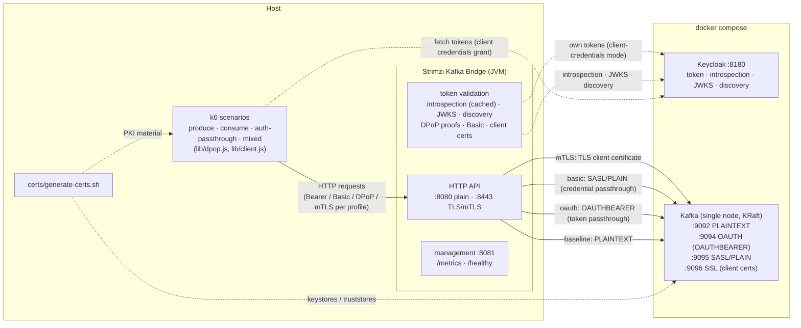

# Load testing and bottleneck analysis

How to load-test the HTTP bridge, measure where the time goes, and attribute
regressions to code paths. The supporting artifacts (Docker Compose environment,
bridge configuration profiles, k6 scenarios) live in `scripts/load-test/`.

## Environment

The load-test environment is a single-node Kafka (KRaft) with four listeners,
and a Keycloak OIDC provider (same setup the OAuth integration tests use):

* `PLAINTEXT` listener on `localhost:9092` - no authentication (baseline)
* `OAUTH` listener on `localhost:9094` - SASL PLAINTEXT with OAUTHBEARER, validated
  against Keycloak by the Strimzi OAuth broker-side handlers bundled in the
  Strimzi Kafka image (tokens from HTTP clients are passed through to Kafka)
* `SASL` listener on `localhost:9095` - SASL PLAINTEXT with static users (Basic
  auth passthrough: the `kafka-broker` user and the `loadtest-user-1..10` pool
  that backs the `USERS` knob of the k6 scripts)
* `SSL` listener on `localhost:9096` - TLS with required client certificates
  (mTLS scenarios; the PKI material comes from `certs/generate-certs.sh`)
* Keycloak on `localhost:8180`, realm `loadtest` imported from
  `scripts/load-test/keycloak/realm-loadtest.json` (confidential clients with
  service accounts: `kafka-broker`, used by the broker, the bridge and the load
  generator, and the `loadtest-user-1..10` pool that backs the `USERS` knob;
  access token lifespan 60 seconds)



The bridge configuration profile (see the
[README](../scripts/load-test/README.md#authentication-scenarios)) selects which
path is exercised: the load generator authenticates per the profile, the bridge
validates (bridge-side token validation, DPoP proofs or client certificates) and
connects to the matching Kafka listener, passing the client identity through
where the mechanism supports it.

```bash
# Kafka (all listeners) + Keycloak (realm "loadtest" auto-imported)
docker compose -f scripts/load-test/docker-compose.yml up -d

# tear down (add -v to drop the Kafka data)
docker compose -f scripts/load-test/docker-compose.yml down
```

The fixed `--hostname=http://localhost:8180` keeps the token issuer stable and
makes the provider advertise host-reachable endpoints, so the bridge and the
load generator reach it through `localhost:8180` - with **directly configured
endpoint URIs** (default) or with the discovery-based resolution (the
`bridge-oauth-discovery` profile). The broker reaches the provider through the
in-network `keycloak:8080` address (explicitly configured endpoint URIs in the
listener JAAS config).

Run the bridge (from the Maven assembly; `mvn package -DskipTests` first if needed):

```bash
java -jar target/kafka-bridge-*.jar --config-file ...   # NOT a runnable jar
# use the assembly run script instead:
target/kafka-bridge-*/kafka-bridge-*/bin/kafka_bridge_run.sh \
    --config-file scripts/load-test/config/bridge-plain.properties
# or, for the OAuth scenarios:
target/kafka-bridge-*/kafka-bridge-*/bin/kafka_bridge_run.sh \
    --config-file scripts/load-test/config/bridge-oauth.properties
```

## Scenarios

The load generator is [k6](https://k6.io) (`dnf install k6` or download the
binary). All scenarios use a constant-arrival-rate executor (constant offered
load, no coordinated omission) and report latency distributions of the produce
or poll requests.

| Scenario | Script | Measures |
|---|---|---|
| Produce | `k6/produce.js` | HTTP layer, JSON conversion, producer path |
| Consume | `k6/consume.js` | consumer path: one consumer per VU, polling `GET .../records` |
| OAuth passthrough | `k6/auth-passthrough.js` | token validation path (introspection/JWKS + caches), with a controlled token rotation rate |
| Mixed | `k6/mixed.js` | all of the above concurrently: competing workloads (produce + consume + authenticated produce + metadata), each with its own arrival rate; per-operation latency trends (`mix_produce_duration`, `mix_poll_duration`, `mix_auth_produce_duration`, `mix_commit_duration`, `mix_list_topics_duration`, `mix_get_topic_duration`) and a combined `mix_errors` rate |
| Peak | `k6/peak.js` | saturation profile: baseline -> linear ramp to `PEAK_RATE` -> peak hold -> recovery, in a single run with per-phase latency trends and error rates (`peak_baseline_*`, `peak_ramp_*`, `peak_hold_*`, `peak_recovery_*`) - where the bridge saturates and that it recovers cleanly |

Key environment variables (see the script headers for the full list):
`RATE` (requests/s), `DURATION`, `RECORDS_PER_REQUEST`, `VALUE_SIZE` (payload
size), and for the OAuth scenario `TOKEN_ROTATION_MARGIN` (seconds subtracted
from the token lifetime when reusing it: `5` reuses the token for most of its
lifetime, `60` - the realm's token lifespan - presents a fresh token on every
request, which is the cache-hostile case).

The mixed scenario has its own rates: `PRODUCE_RATE`, `CONSUME_RATE`,
`AUTH_RATE` (0 disables a scenario), `METADATA_RATE` (list/get topic requests,
default 5) and `CONSUME_VUS`. The consume leg commits the polled offsets after
each poll that returned records (`COMMIT_OFFSETS=0` disables). With
`AUTH_RATE > 0` (use the OAuth bridge configuration) **every** operation of the
mix is authenticated, because the OAuth passthrough bridge requires a token on
each request; with `AUTH_RATE = 0` the mix runs unauthenticated (plain bridge
configuration).

```bash
# baseline produce throughput/latency
k6 run -e RATE=500 -e DURATION=60s scripts/load-test/k6/produce.js

# consume (produce messages first)
k6 run -e VUS=10 -e RATE=100 scripts/load-test/k6/consume.js

# OAuth passthrough, fresh token on every request (cache-hostile)
k6 run -e TOKEN_ROTATION_MARGIN=60 -e RATE=100 scripts/load-test/k6/auth-passthrough.js

# 60/10/30 produce/consume/auth mix under a cache-hostile rotation, OAuth bridge
k6 run -e PRODUCE_RATE=60 -e CONSUME_RATE=10 -e AUTH_RATE=30 \
    -e TOKEN_ROTATION_MARGIN=60 scripts/load-test/k6/mixed.js

# same mix unauthenticated, plain bridge
k6 run -e PRODUCE_RATE=60 -e CONSUME_RATE=10 -e AUTH_RATE=0 scripts/load-test/k6/mixed.js
```

### OpenAPI operations coverage

The kit covers the **hot path** (the steady-state produce/consume traffic whose
throughput and latency matter) plus the most frequent control-plane requests:
10 of the 25 OpenAPI operations. The complete API surface is covered by the
integration tests (`ConsumerIT`, `ConsumerSubscriptionIT`, `SeekIT`,
`ProducerIT`, `AdminClientIT`, `OtherServicesIT`), which exercise all 25
operations - the auth ITs re-exercise the main paths under every authentication
mechanism.

| Operation | Path | Load-tested by |
|---|---|---|
| `send` | `POST /topics/{topicname}` | `produce.js`, `mixed.js` (produce leg), `auth-passthrough.js` |
| `createConsumer` | `POST /consumers/{groupid}` | `consume.js`, `mixed.js` |
| `subscribe` | `POST .../subscription` | `consume.js`, `mixed.js` |
| `poll` | `GET .../records` | `consume.js`, `mixed.js` (consume leg) |
| `commit` | `POST .../offsets` | `mixed.js`: after each poll that returned records, the polled offsets are committed (the steady-state consumer loop with `enable.auto.commit=false`; `COMMIT_OFFSETS=0` disables) |
| `listTopics` | `GET /topics` | `mixed.js` (metadata leg, `METADATA_RATE`, default 5/s) |
| `getTopic` | `GET /topics/{topicname}` | `mixed.js` (metadata leg: the target topic is fetched whenever it is listed) |
| `deleteConsumer` | `DELETE /consumers/{groupid}/instances/{name}` | `consume.js`, `mixed.js` (teardown sweep) |
| `healthy` | `GET /healthy` | observed with `curl` before/during every run |
| `metrics` | `GET /metrics` | observed with `curl` during every run (see "Observing the bridge") |

Not load-tested (low-frequency seek/assignment and admin/metadata operations;
the integration tests are the appropriate coverage for them): `seek`,
`seekToBeginning`, `seekToEnd`, `assign`, `listSubscriptions`,
`unsubscribe`, `listPartitions`, `getPartition`, `sendToPartition`,
`getOffsets`, `createTopic`, `info`, `ready`, `openapi`, `openapiv3`.

Validated in the 60/10 mix (30 s runs, 0% errors): the commit requests average
~3 ms on the plain bridge, ~13 ms under JWKS validation and ~29 ms under DPoP
(fresh token and proof per request); the metadata requests (`listTopics`,
`getTopic`) stay in the single-digit milliseconds. The committed offsets are
observable on the broker (`kafka-consumer-groups --describe` shows the
`mix-consumers` group tracking the log-end offset).

## Authentication mechanisms

Every authentication mechanism of the bridge is covered by a configuration
profile (see the README for the profile list and the PKI generation) and was
validated under load against the compose environment (30 s runs, single
machine; the numbers are indicative, not absolute - the Keycloak `start-dev`
mode dominates the introspection latency):

| Mechanism / validation | Profile | Load | Errors | p95 |
|---|---|---|---|---|
| none (baseline) | `bridge-plain` | `produce.js` 300/s | 0% | ~10 ms |
| OAuth Bearer + introspection (cache on) | `bridge-oauth` | `auth-passthrough.js` 100/s, fresh token per request | 0% | ~1.9 s |
| OAuth Bearer + JWKS | `bridge-oauth-jwks` | same | 0% | ~29 ms |
| OAuth Bearer, no bridge-side validation | `bridge-oauth-none` | same | 0% | ~110 ms |
| OAuth Bearer + introspection, cache off | `bridge-oauth-nocache` | same | 0% | ~1.1 s |
| OAuth Bearer + discovery | `bridge-oauth-discovery` | same | 0% | ~0.9 s |
| OAuth client-credentials (bridge-side) | `bridge-oauth-cc` | `produce.js` 300/s, no auth headers | 0% | ~9 ms |
| DPoP sender-constrained tokens | `bridge-oauth-dpop` | `auth-passthrough.js` (`AUTH_SCHEME=dpop`) 50/s, fresh token and proof per request | 0% | ~28 ms |
| DPoP, ES256 (generated EC key pool) | `bridge-oauth-dpop` | `auth-passthrough.js` (`AUTH_SCHEME=dpop`) 50/s, reused tokens (default margin) | 0% | ~11 ms |
| DPoP, RS256 (legacy RSA key file, comparison) | `bridge-oauth-dpop` | same with `DPOP_KEY_FILE` pointing at a legacy RSA key file | 0% | ~14 ms |
| Basic (SASL/PLAIN passthrough) | `bridge-basic` | `auth-passthrough.js` (`AUTH_SCHEME=basic`) 100/s | 0% | ~10 ms |
| mTLS client certificates | `bridge-mtls` | `produce.js` (mTLS) 200/s | 0% | ~10 ms (p95 dominated by a startup outlier) |
| mixed + JWKS | `bridge-oauth-jwks` | `mixed.js` 60/10/30, fresh tokens | 0% | — |
| mixed + Basic | `bridge-basic` | `mixed.js` 60/10/30 | 0% | — |

What the numbers show (single-run, 30 s, fresh token per request where
applicable):

* the **validation mode dominates the per-request cost of the OAuth paths**:
  JWKS (local signature check) is ~1 ms scale, introspection is provider-bound
  (Keycloak dev mode: ~1 s scale) - the introspection cache turns the per-request
  cost back into the ~1 ms scale once tokens are reused (the default rotation
  margin)
* **DPoP adds a per-request proof validation** (signature check against the
  embedded JWK, claim checks, replay-cache lookup) on top of the token
  validation: visible but small compared to any provider call
* **Basic and mTLS passthrough** add no meaningful per-request cost at the
  bridge (credential parsing and certificate validation vs. the Kafka client
  path)
* the fresh-token (cache-hostile) introspection runs are also the memory-growth
  case of the per-token caches: watch `strimzi_bridge_auth_cache_entries` and
  `strimzi_bridge_auth_cache_evictions_total` during them

**Multi-user (`USERS`)**: by default every VU of a scenario shares one identity
(same client, same Basic user, same certificate, same DPoP key), though each VU
still owns its HTTP connection, its token and its consumer instance. With
`USERS=N` the VUs authenticate with distinct identities from the pool of 10
(Keycloak clients or SASL/PLAIN users `loadtest-user-1..10`, distinct DPoP keys
from `dpop-keys.json`), which also exercises the consumer-ownership checks and
the per-credentials caches of the bridge against real identity diversity. A
validated run: `auth-passthrough.js` with `USERS=10` (introspection) reached
128 distinct live tokens from 10 principals at 0% errors; `mixed.js` with
`USERS=5` (JWKS and DPoP variants) at 0% errors. For mTLS, run one k6 process
per certificate (k6 cannot select the client certificate per VU).

**Peak load (saturation profile)**: `peak.js` runs baseline -> linear ramp ->
peak hold -> recovery in one run, with per-phase latency and error metrics.
Validated against the plain bridge profile (1 KB records, 1 record per request,
dev machine):

* `BASE_RATE=100 -> PEAK_RATE=1000` (60s ramp): flat throughout - all phases at
  p95 ~7-11 ms, 0 errors over ~69k requests, executor queue never contended
* `BASE_RATE=200 -> PEAK_RATE=3000` (45s ramp): the ramp stays flat (p95
  ~8 ms), the sustained hold at ~2.9k/s degrades (p95 ~181 ms, max ~768 ms) and
  the recovery returns to the baseline exactly (p95 ~6.8 ms) - 0 errors
  (~170k requests)
* `BASE_RATE=500 -> PEAK_RATE=6000` (45s ramp): the ramp itself now ramps up
  progressively (p95 ~176 ms), the hold at ~3.9k/s actual sits at p95 ~193 ms
  (max ~1.1 s), recovery clean (p95 ~6.5 ms) - still 0 errors (~369k requests)

The findings: the latency ramp shows up **before** any error - the bridge keeps
accepting (0 errors, `executor_rejected_tasks_total` stayed 0, the executor
queue never drained) while the request latency grows with the offered load, so
the saturation point of a configuration is read from the latency trend, not
from errors. The recovery phase returning exactly to the baseline latency (and
0 errors) after every run verifies there is no residual degradation. Note that
the achievable offered rate is capped by `MAX_VUS` (default 500): the 6000/s
run scheduled only ~3.9k/s at the hold because 500 VUs × ~130 ms latency bound
the in-flight requests - raise `MAX_VUS` (and `VUS`) when pushing the peak
higher.

Validated authenticated peak runs (same profile shape): the **JWKS bearer** run
(100 -> 500/s, `USERS=3`) stays flat in every phase (ramp and hold at p95
~7 ms, 0 errors) - the per-token validation caches make the authenticated path
as scalable as the plain one under token reuse. The **DPoP** run (100 -> 400/s,
ES256, `USERS=3`) instead shows a real saturation of the bridge event loop: 0
errors and valid proofs throughout, but the sustained hold at 400/s degrades to
p95 ~1.5 s (the ramp still flat at p95 ~26 ms), and a constant-rate control run
measures the onset between 200/s (p95 ~14 ms) and 400/s (p95 ~126 ms). The
cause: the DPoP proof validation (JWT parse + signature + claims + replay
cache) runs on the Vert.x event loop (a single deployed verticle instance on
the dev machine) at a per-request cost of a few milliseconds - roughly 15x the
plain produce path - so ~400/s consumes the whole loop while the executor (and
the Kafka path) stays idle. This matches the ES256-vs-RS256 recommendation
above (cheaper verification buys headroom) and motivates a potential follow-up:
offloading the proof validation from the event loop, as the Kafka calls already
are.

A scenario run is meaningful only against a **stable, verified setup**: check
`GET /healthy` (management port, `8081`) before starting, and confirm the error rate in the k6 summary is
~0% (a rising error rate means the bridge is overloaded - the latency numbers
then measure queueing, not the code path).

## Long-running runs

The 30-60s validations measure per-request behavior. The **time-dependent**
behaviors need a long run (10 minutes is a good default): many token rotations
or the caches at their bound, the JWKS refresh cadence (default 300s), consumer
group stability over long sessions, and the memory trend.

`scripts/load-test/longrun.sh` wraps this: it drives `k6/mixed.js` for
`DURATION` (default `10m`) while sampling the bridge metrics (auth caches,
validation counters, executor, JVM heap) every `SAMPLE_INTERVAL` seconds
(default 15), plus `jcmd` heap snapshots when `BRIDGE_PID` is set (autodetected
from the java command line). The bridge must already be running; artifacts land
in `longrun-results/<timestamp>/` (k6 summary, `metrics-samples.txt`,
`heap-samples.txt`) and a first/last/peak trend of the sampled series is
printed at the end.

```bash
# sustainable 10-minute run (default rates)
scripts/load-test/longrun.sh

# long run over OAuth: use the client-credentials profile - the bridge fetches
# and refreshes its own tokens, so its broker connections survive re-auth across
# the whole run (the HTTP clients stay unauthenticated, hence AUTH_RATE=0)
BRIDGE_PID=$(pgrep -f io.strimzi.kafka.bridge.Application) \
AUTH_RATE=0 scripts/load-test/longrun.sh   # with bridge-oauth-cc.properties
```

Read the results as:

* `cache_entries` at a stable working size (or exactly at the configured bound)
  with `cache_evictions_total` advancing at the token-rotation rate = the
  bounded caches working as designed
* the sampled heap **plateauing** after warm-up = bounded (Guava cache internals
  and Kafka client buffers are the expected plateau); a monotonic growth across
  the samples is a leak - attribute it with `jcmd GC.class_histogram` trend and
  a JFR allocation profile (see "Memory under rotating tokens" below)
* the k6 error rate at 0% for the whole run: token rotations, re-authentications
  and rebalances must be invisible to the clients

**Finding: OAuth passthrough consumers cannot outlive the token lifetime.**
The long run surfaced a real operational characteristic of the passthrough
design: a consumer authenticates with the token of the request that created it
and keeps that token until it is deleted (see the design document,
"Authentication modes") - it cannot obtain a fresh one. With the `loadtest`
realm's 60-second token lifespan, the consumer's broker connection fails
re-authentication at the first expiry (`Failed re-authentication ... Token
expired`), the group falls into a coordinator-rediscovery loop
(`NOT_COORDINATOR`), and the polls return errors - exactly what a 10-minute
`TOKEN_ROTATION_MARGIN=60` run shows. The short (30 s) validations never cross
the expiry, so they cannot see this. Producers are unaffected (the internal
producer is recreated per fresh token). For a long **authenticated-passthrough**
run, raise the realm's token lifespan first (`accessTokenLifespan` in
`keycloak/realm-loadtest.json`, Keycloak reimports the realm at container
recreation) so it comfortably exceeds the run duration - or accept consumer
churn as part of the measured behavior.

A validated reference run (10 min, client-credentials mode, 60/10/5 mix, 0%
errors over ~51k requests): the bridge's own tokens refreshed on schedule, the
broker re-authentications invisible to the clients, and the sampled heap
plateauing after warm-up. The fresh-token (cache-hostile) cache-bound behavior
is validated in the short runs (see "Authentication mechanisms" above).

### Validated results (10-minute runs, 60/10/5 mix, single machine)

**Sustainable run** - client-credentials mode (`bridge-oauth-cc.properties`,
`AUTH_RATE=0`, `USERS=1`, `BRIDGE_PID` heap sampling, 15s sample interval):

| Aspect | Result |
|---|---|
| Errors | **0%**: 51,131/51,131 checks, 51,431 requests (85.6/s) over the full 10 minutes |
| Produce (`send`) | p95 7.8 ms |
| Commit (after each poll) | p95 2.2 ms |
| Metadata (`listTopics` / `getTopic`) | p95 2.5 / 2.8 ms |
| Poll (long-poll `timeout_ms=1000`) | p95 1 s (the long-poll floor), median 2.3 ms when records are waiting |
| Heap (sampled, 41 samples) | old generation 27 → 40 MB within the first 2 minutes, then **flat at ~40 MB for the remaining 8** (peak heap 75 MB): the plateau, not growth, that the run exists to verify |
| Bridge-side identity | authenticated as `service-account-kafka-broker`; zero authentication failures in the bridge log across the run (its own-token refresh and the broker re-authentications were invisible to the clients) |
| Sampling artifacts | `metrics-samples.txt` (41 timestamped samples), `heap-samples.txt`, `k6-summary.txt` |

**Failure run** - OAuth passthrough + JWKS with fresh tokens per request
(`TOKEN_ROTATION_MARGIN=60`, `USERS=3`), the run that exposed the
consumer-token finding above:

| Aspect | Result |
|---|---|
| Errors | 4.13% of checks (5,498/132,902); `mix_errors` 8.29% |
| `poll` | ✓ 507 / ✗ 5,494 - polls fail from the first consumer-token expiry (~60s into the run) onward |
| `commit` | ✓ 273 / ✗ 3 (only after successful polls) |
| Produce legs | unaffected (0% errors): the internal producer is recreated per fresh token |
| Bridge log | `Failed re-authentication ... Token expired` per consumer connection, then the group stuck in `NOT_COORDINATOR` rediscovery |

The two runs together bracket the behavior: with bridge-managed tokens the
10-minute run is clean; with passthrough consumers and tokens shorter than the
run, the consumer sessions die at the first expiry (see the finding above).

## Method: find the bottleneck

Change one variable at a time, measure, compare. The workflow:

1. **Baseline**: run the scenario at a rate the bridge sustains with <1% errors
   and note the latency percentiles (`http_req_duration` p50/p95/p99) and the
   throughput (`http_reqs` rate).
2. **Ramp**: increase `RATE` by steps until latency or errors degrade. The rate
   at which p99 degrades is the practical capacity for that configuration.
3. **Attribute**: while the bridge saturates, capture what it is doing (see
   "Observing the bridge" below). The result is a combination of:
   * which resource saturates (CPU, threads, connections, the provider, Kafka)
   * which code path the profiles point at
4. **Iterate**: change one knob (configuration or code), re-run the same
   scenario, compare percentiles.

### The knobs (configuration)

| Knob | Default | Effect |
|---|---|---|
| `bridge.executor.pool.size` | `max(4, CPUs * 2)` | threads offloading the blocking Kafka calls; undersized, the requests queue in the executor |
| `bridge.executor.queue.size` | `1000` | executor queue; a full queue rejects requests - watch it as a saturation signal |
| `kafka.linger.ms`, `kafka.batch.size` | 0 / 16 KiB | producer batching: the main throughput lever for the produce path |
| `kafka.acks` | `-1` (all) | `1` trades durability for latency/throughput |
| `authentication.introspection.cache.seconds` | `30` | with token validation: how often the same token re-hits the provider (0 = never cached) |
| `authentication.jwks.refresh.seconds` | `300` | JWKS refresh cadence (signature validation only; no per-token provider call) |

### The knobs (scenario)

* `RECORDS_PER_REQUEST`: many small records per request exercise the
  JSON-to-Kafka conversion (`io.strimzi.kafka.bridge.http.converter`) rather
  than the HTTP layer
* `VALUE_SIZE`: large payloads shift the cost to buffering and to the Kafka
  producer (compression, batching)
* `VUS`: concurrency against the executor and the Kafka clients
* `TOKEN_ROTATION_MARGIN` (OAuth): the rotation rate of tokens, i.e. the cache
  hit ratio of the token validation path

## Observing the bridge

### Metrics (`GET /metrics`)

The management endpoints (`/metrics`, `/healthy`, `/ready`) are exposed on the
**management port** (`http.management.port`, default `8081`, separate from the
API port `8080`). Scrape during the run
(e.g. `watch -n5 'curl -s localhost:8081/metrics | grep ...'`)
and correlate with the k6 latency percentiles. The interesting series:

| Metric family | What it tells |
|---|---|
| `strimzi_bridge_http_server_*` (Vert.x) | per-route request counts, durations and active requests: is the time spent in the HTTP layer or behind it? |
| `executor_*` (name `kafka-bridge`: `executor_queue_remaining_tasks`, `executor_active_threads`, `executor.queued`...) | saturation of the executor offloading the blocking Kafka calls: queue depth dropping to 0 = requests waiting for threads; `executor_rejected_tasks_total` = queue full |
| `strimzi_bridge_auth_rejected_total` | rejected authentications under load (misconfigured rotation, clock skew) |
| `strimzi_bridge_auth_introspection_total{result}` | provider call rate: should be ~0/s after warm-up when the caches work |
| `strimzi_bridge_auth_introspection_cache_total{result="hit"\|"miss"}` | introspection cache effectiveness: `miss` rate ≈ token rotation rate; `hit`/(`hit`+`miss`) is the cache hit ratio |
| `strimzi_bridge_auth_introspection_duration` / `strimzi_bridge_auth_signature_duration` | where the validation time goes: provider latency (introspection) vs CPU (signature verification) |
| `strimzi_bridge_auth_introspection_inflight` | concurrency against the provider |
| `strimzi_bridge_auth_last_success{endpoint}` | seconds since the last successful provider interaction: alertable provider-outage signal (grows unbounded when the bridge fails closed) |
| `strimzi_bridge_auth_jwks_keys` | keys served by the JWKS chain (0 = empty/degenerate key set) |
| `strimzi_bridge_auth_jwks_unknown-kid_total` | tokens with a `kid` matching no cached key: key rotation ahead of refresh, or forged tokens |
| `strimzi_bridge_auth_dpop_total{result}` | DPoP validation outcomes with the granular reasons; `result="replayed"` is the replay-attack indicator |
| `strimzi_bridge_auth_cache_entries{cache}` / `strimzi_bridge_auth_cache_evictions_total{cache}` | the bounded per-token caches (introspection, dpop-replay, admin) at their working size; a rising eviction rate = bound too tight |
| Kafka producer/consumer metrics (via `strimziMetricsReporter`) | `record-queue-time`, `batch-size`, compression ratio, fetch lag: the Kafka-side story of the same load |
| JVM (`jvm_gc_*`, `jvm_memory_*`) | GC pressure and heap stabilization |

### Profiling

CPU profiles answer "which code path" directly:

```bash
# JFR (no extra tooling, ships with the JDK): 3-minute profile during saturation
jcmd <bridge-pid> JFR.start duration=3m filename=bridge.jfr settings=profile
jfr summary bridge.jfr
# open bridge.jfr in JDK Mission Control, or:
jfr print --events ExecutionSample,AllocationSample bridge.jfr > jfr.txt

# async-profiler (flame graphs, best signal-per-effort):
# https://github.com/async-profiler/async-profiler/releases
asprof -d 120 -f flamegraph.html <bridge-pid>
```

Read the flame graph top-down at the moment of saturation. Typical shapes:

* dominated by `kafka.producer.KafkaProducer.send` → producer batching (tune
  `linger.ms`/`batch.size`, or the request is CPU-bound in compression)
* dominated by JSON/Jackson or the converter classes → conversion cost (test
  `binary` format vs `json`, or `RECORDS_PER_REQUEST` batching)
* dominated by JWT signature verification (`com.nimbusds...`) → the validation
  path is CPU-bound (expected: RS*/PS*/ES* verification is CPU-heavy per token;
  that is what the JWKS validation mode measures)
* dominated by socket reads waiting on the introspection endpoint → the provider
  is the bottleneck (the validation path inherits the provider latency for every
  uncached token - this is the `introspection.cache.seconds=0` case)
* many threads parked on the executor queue → increase
  `bridge.executor.pool.size`, or the Kafka round-trips are simply slow

Also watch the bridge log for Vert.x *blocked thread check* warnings: those are
synchronous code running on event loops, the most serious class of bottleneck
in a Vert.x application.

### Memory under rotating tokens

The per-token caches (admin clients, introspection results, DPoP replay) are
bounded, but a load with constantly rotating tokens is exactly the traffic that
grows them to their bounds. To verify the bounds hold:

```bash
# run the auth scenario with TOKEN_ROTATION_MARGIN=60 (fresh token per request) for several minutes, then:
jcmd <bridge-pid> GC.class_histogram | head -25   # repeat every ~30s
```

The histogram should plateau (Guava cache internals, Kafka client buffers),
not grow monotonically. A growing `Guava-Cache` or
`KafkaBridgeAdmin`/producer-related footprint across many rotations indicates a
leak; `jcmd GC.heap_info` and a JFR allocation profile attribute it.

## Recommendations from the measurements

Actionable outcomes of the load-testing campaign, most impactful first:

1. **Prefer JWKS (signature-only) validation over introspection** whenever the
   provider supports it. The fresh-token runs put the whole request at p95
   ~29 ms (JWKS, local RS256 check) vs ~1.9 s (introspection, a provider call
   per uncached token; ~1.1 s with the cache disabled). Introspection buys
   immediate revocation - pay for it only where revocation latency matters,
   and keep `authentication.introspection.cache.seconds` enabled (0 disables
   the cache and multiplies the provider load by the request rate).
2. **Keep client token reuse sane.** The caches are keyed per token: with the
   default rotation margin clients reuse a token for most of its lifetime and
   the per-token caches work at ~1 ms scale. The fresh-token (cache-hostile)
   runs are the worst case for every per-token cache - notably the admin
   cache: in the passthrough long run, five metadata request-pairs per second
   with fresh tokens churned **~5,900 admin-client creations + evictions in 10
   minutes** (each cached admin client is a full Kafka client with broker
   connections; the cache is bounded at 100 and keyed per raw credentials, so
   a rotating token never hits it). Bounded, so no leak - but the churn is
   pure overhead that sensible token reuse avoids.
3. **Set the token lifespan comfortably above the consumer session length**
   (the long-run finding): consumers keep the token of their creation request,
   so with short-lived tokens their broker connections fail re-authentication
   mid-session and the group falls into rebalancing with poll errors. This is
   now implemented as the opt-in
   `authentication.consumer.credentials.refresh` bridge option: with the token
   validation enabled, an expired pinned token is replaced by a valid token of
   the same principal presented on a subsequent consumer request (the underlying
   Kafka consumer is recreated, preserving the subscription; see the design doc
   for the trade-offs). Without the option, keep the token lifespan above the
   consumer session length.
4. **For high-rate DPoP, prefer ES256 proofs over RS256.** The validator
   accepts both (and PS*); ECDSA verification is markedly cheaper CPU-wise
   than 2048-bit RSA, and the fresh-token JWKS runs show the signature check
   is the dominant per-request cost on that path (~29 ms p95 vs ~10 ms plain).
   Measured per-proof verification cost on the bridge
   (`strimzi_bridge_auth_signature_duration`, 50/s produce runs): ES256
   ~0.097 ms vs RS256 ~0.115 ms (~16% cheaper) - the kit signs ES256 by default
   now (the generated DPoP key pool is EC P-256); legacy RSA key files still
   work via `DPOP_KEY_FILE` for RS256 comparisons.
5. **Producer batching is the produce-throughput lever, only when scaling.**
   The defaults sustained 300/s at p95 ~10 ms; before tuning `kafka.linger.ms`
   / `kafka.batch.size` / `kafka.acks`, check you are actually near the
   saturation point (executor metrics + latency ramp, see "Method") - the
   `peak.js` scenario automates exactly that: a ramp to the peak rate shows the
   latency ramp and the error onset, and the recovery phase verifies the bridge
   returns to the baseline cleanly.
6. **No action needed on the control-plane paths**: `commit`, `listTopics`,
   `getTopic` measure at p95 ~2-3 ms over the whole 10-minute run - they need
   no caching or tuning; and Basic/mTLS passthrough added no measurable
   per-request cost at the bridge.

## Interpreting common results

| Symptom | Likely bottleneck | Where to look |
|---|---|---|
| p50 low, p99 huge, executor queue growing | executor pool exhausted by slow Kafka calls | `bridge.executor.pool.size`, Kafka listener latency |
| latency grows with `VUS`, CPU flat | lock contention or connection pool exhaustion | JFR (monitor enter), Kafka client metrics |
| produce throughput caps at low CPU | producer batching (`linger.ms=0` sends per record) | `kafka.linger.ms`, `kafka.batch.size` |
| OAuth scenario caps where plain doesn't | validation path adds provider latency or CPU | introspection counters on `/metrics`, JFR nimbus frames, `cache.seconds` |
| error rate rises past saturation | executor queue full (bridge rejects) or provider timeouts | bridge log, `bridge.executor.queue.size` |
| memory grows under token rotation | cache bounds or a leak | GC class histogram trend, JFR allocation profile |

## Notes

* The load-test environment is for development measurements only (no TLS, no
  authorization, single broker); absolute numbers are indicative, relative
  numbers (before/after a change) are the meaningful result.
* Run the load generator and the bridge on the same machine only for small
  rates; for higher rates, separate the machines (or containers with CPU
  limits) so the load generator does not compete with the bridge for CPU.
* Docker image tags in `scripts/load-test/docker-compose.yml` are pinned for
  reproducibility; bump them deliberately (they change the Kafka and Keycloak
  behavior under test).
