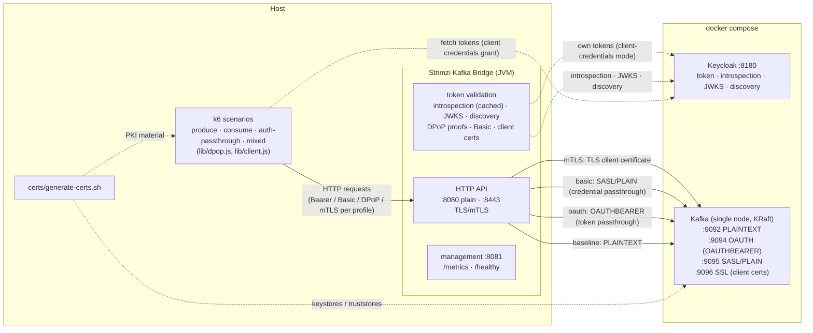

# Load test kit for the HTTP bridge

Docker Compose environment (single-node Kafka + Keycloak OIDC provider), bridge
configuration profiles and k6 scenarios for load testing the bridge and finding
bottlenecks.

The methodology (metrics to watch, JFR/async-profiler profiling, bottleneck
checklist) is documented in [development-docs/LOAD-TESTING.md](../../development-docs/LOAD-TESTING.md).

## Quick start

```bash
# 1. PKI material for the TLS-based scenarios (mTLS, DPoP), generated locally
scripts/load-test/certs/generate-certs.sh

# 2. Kafka (all four listeners) + Keycloak
docker compose -f scripts/load-test/docker-compose.yml up -d

# 3. Build and run the bridge (Maven assembly run script, not the bare jar)
mvn package -DskipTests
BRIDGE=target/kafka-bridge-*/kafka-bridge-*/bin/kafka_bridge_run.sh
$BRIDGE --config-file scripts/load-test/config/bridge-plain.properties
# or one of the authentication profiles (see the table below), e.g.:
$BRIDGE --config-file scripts/load-test/config/bridge-oauth.properties

# 4. Load
k6 run -e RATE=500 scripts/load-test/k6/produce.js
k6 run -e VUS=10 -e RATE=100 scripts/load-test/k6/consume.js          # produce some messages first
k6 run -e RATE=100 -e TOKEN_ROTATION_MARGIN=60 scripts/load-test/k6/auth-passthrough.js
k6 run -e PRODUCE_RATE=60 -e CONSUME_RATE=10 -e AUTH_RATE=30 -e TOKEN_ROTATION_MARGIN=60 scripts/load-test/k6/mixed.js

# 5. Observe (management endpoints are on port 8081 by default)
curl -s localhost:8081/metrics | grep -v '^#'
jcmd <bridge-pid> JFR.start duration=3m filename=bridge.jfr settings=profile
```

## Architecture



The bridge configuration profile selects which path is exercised (see the
authentication scenarios table below): the load generator authenticates
per the profile, the bridge validates (bridge-side token validation, DPoP
proofs or client certificates) and connects to the matching Kafka listener,
passing the client identity through where the mechanism supports it.

## Layout

| Path | Purpose |
|---|---|
| `docker-compose.yml` | Kafka (PLAINTEXT 9092, OAUTH 9094, SASL/PLAIN 9095, SSL 9096 listeners) and Keycloak (port 8180) |
| `kafka/server.properties` | broker configuration for all listeners |
| `keycloak/realm-loadtest.json` | `loadtest` realm: confidential clients with service accounts (`kafka-broker` + the `loadtest-user-1..10` pool for the `USERS` knob, 60s token lifespan) |
| `certs/generate-certs.sh` | generates the PKI material for the mTLS and DPoP scenarios into `certs/generated/` (local CA, bridge server/client certs, broker keystore, DPoP EC P-256 key pool) |
| `config/bridge-plain.properties` | bridge config: baseline, no auth, PLAINTEXT listener |
| `config/bridge-oauth.properties` | bridge config: OAuth passthrough with introspection validation (+ commented variants) |
| `config/bridge-oauth-jwks.properties` | OAuth passthrough with JWKS (signature-only) validation |
| `config/bridge-oauth-none.properties` | OAuth passthrough without bridge-side validation (broker-side only) |
| `config/bridge-oauth-nocache.properties` | OAuth passthrough with introspection, cache disabled |
| `config/bridge-oauth-discovery.properties` | OAuth passthrough with the endpoints resolved from the OIDC discovery document |
| `config/bridge-oauth-dpop.properties` | OAuth passthrough with JWKS validation and DPoP sender-constrained tokens |
| `config/bridge-oauth-cc.properties` | OAuth client-credentials bridge mode (the bridge fetches its own tokens, HTTP clients unauthenticated) |
| `config/bridge-basic.properties` | Basic auth passthrough (HTTP Basic credentials to the SASL/PLAIN listener) |
| `config/bridge-mtls.properties` | HTTPS with required client certificates (mTLS) |
| `k6/lib/dpop.js` | DPoP proof signer (pure-JS ECDSA P-256 / RSA on BigInt, fresh proof per request; ES256 with the generated EC keys, RS256 with legacy RSA key files) |
| `k6/lib/client.js` | k6 `tlsAuth` options fragment from `TLS_CLIENT_CERT`/`TLS_CLIENT_KEY` |
| `k6/produce.js` | constant-rate `POST /topics/{topic}` |
| `k6/consume.js` | one consumer per VU, constant-rate `GET .../records` polling |
| `k6/auth-passthrough.js` | produce with configurable authentication (`AUTH_SCHEME=bearer\|basic\|dpop`), token rotation rate and optional mTLS |
| `k6/peak.js` | peak load profile: baseline -> linear ramp to the peak -> peak hold -> recovery, one scenario (and metrics set) per phase, to find the saturation point and verify the recovery |
| `k6/mixed.js` | concurrent produce + consume + (optionally) authenticated produce + metadata requests, each with its own constant arrival rate; the consume leg commits the polled offsets after each poll |
| `longrun.sh` | long-running load test (default 10m): drives `k6/mixed.js` while sampling the bridge metrics and heap, so cache bounds, JWKS refreshes and the memory trend are observable over time |

The scenarios cover the hot path of the API plus the most frequent
control-plane requests (10 of the 25 OpenAPI operations: `send`,
`createConsumer`, `subscribe`, `poll`, `commit`, `listTopics`, `getTopic`,
`deleteConsumer` plus the observed `/healthy` and `/metrics`); the full
operation-by-operation mapping is in
[LOAD-TESTING.md](../../development-docs/LOAD-TESTING.md#openapi-operations-coverage).

## Long-running runs

The short validations measure per-request behavior; a **long run** exercises the
time-dependent behaviors: the bridge-side token lifecycle, consumer-group
stability over long sessions, and above all the **memory trend**. `longrun.sh`
drives `k6/mixed.js` for a long duration while sampling the bridge metrics and
heap:

```bash
# sustainable 10-minute run (plain bridge, default rates), heap sampling autodetected
scripts/load-test/longrun.sh

# long run over OAuth: the client-credentials profile - the bridge fetches and
# refreshes its own tokens, so its broker connections survive re-auth across the
# whole run (AUTH_RATE=0: the HTTP clients stay unauthenticated in this mode)
BRIDGE_PID=$(pgrep -f io.strimzi.kafka.bridge.Application) \
AUTH_RATE=0 scripts/load-test/longrun.sh   # with bridge-oauth-cc.properties
```

> **Note**: with the OAuth **passthrough** profiles, consumers keep the token of
> their creation request until deletion, so with the realm's 60s token lifespan
> their broker connections fail re-authentication mid-run and polls return
> errors - an authentic finding of the long run (see LOAD-TESTING.md,
> "Long-running runs"). For a long authenticated-passthrough run, raise
> `accessTokenLifespan` in `keycloak/realm-loadtest.json` above the run duration
> first.

The bridge must already be running; artifacts land in
`longrun-results/<timestamp>/` (k6 summary, timestamped metric samples, heap
snapshots when `BRIDGE_PID` is set) and a trend of the interesting series (cache
entries/evictions, heap used) is printed at the end. What to look for:

* the sampled heap plateaus after warm-up (Guava caches, Kafka client buffers);
  a linear growth over the run is a leak candidate - attribute it with the
  methods in LOAD-TESTING.md ("Memory under rotating tokens")
* the k6 error rate stays at 0% for the whole run (token rotations,
  re-authentications and group rebalances must be invisible to the clients)

Validated 10-minute results (full numbers in
[LOAD-TESTING.md](../../development-docs/LOAD-TESTING.md#validated-results-10-minute-runs-60105-mix-single-machine)):
the client-credentials run is clean (0% errors over 51k requests, produce p95
7.8 ms, commit p95 2.2 ms, old-gen heap flat at ~40 MB after warm-up), while
the passthrough run with fresh tokens reproduces the consumer-token expiry
finding (polls fail from the first token expiry onward).

## Authentication scenarios

Every supported authentication mechanism of the bridge has a validated profile
and load scenario (see LOAD-TESTING.md for the validated runs and results):

| Mechanism | Bridge profile | k6 invocation |
|---|---|---|
| none (baseline) | `bridge-plain.properties` | `produce.js`, `consume.js`, `mixed.js` |
| OAuth Bearer + introspection | `bridge-oauth.properties` | `k6 run -e TOKEN_ROTATION_MARGIN=60 -e RATE=100 scripts/load-test/k6/auth-passthrough.js` |
| OAuth Bearer + JWKS | `bridge-oauth-jwks.properties` | same, with the jwks profile |
| OAuth Bearer, no bridge-side validation | `bridge-oauth-none.properties` | same, with the none profile |
| OAuth Bearer + introspection, cache off | `bridge-oauth-nocache.properties` | same, with the nocache profile |
| OAuth Bearer + discovery | `bridge-oauth-discovery.properties` | same, with the discovery profile |
| OAuth client-credentials (bridge-side) | `bridge-oauth-cc.properties` | `k6 run scripts/load-test/k6/produce.js` (no auth headers) |
| DPoP sender-constrained tokens | `bridge-oauth-dpop.properties` | `k6 run -e AUTH_SCHEME=dpop -e TOKEN_ROTATION_MARGIN=60 -e RATE=50 scripts/load-test/k6/auth-passthrough.js` |
| Peak load (ramp -> peak -> recovery) | any profile (`AUTH_SCHEME` support) | `k6 run -e BASE_RATE=100 -e PEAK_RATE=1000 scripts/load-test/k6/peak.js` |
| Basic (SASL/PLAIN passthrough) | `bridge-basic.properties` | `k6 run -e AUTH_SCHEME=basic -e RATE=100 scripts/load-test/k6/auth-passthrough.js` |
| mTLS client certificates | `bridge-mtls.properties` | see below |

mTLS run (the TLS API listens on 8443; the paths must be absolute, `SSL_CERT_FILE`
makes k6 trust the local CA):

```bash
CERTS=$PWD/scripts/load-test/certs/generated
SSL_CERT_FILE=$CERTS/ca-cert.pem \
TLS_CLIENT_CERT=$CERTS/loadtest-client-cert.pem \
TLS_CLIENT_KEY=$CERTS/loadtest-client-key.pem \
BASE_URL=https://localhost:8443 \
k6 run -e RATE=200 scripts/load-test/k6/produce.js
```

Notes:

* **`USERS` (multi-user)**: by default every VU authenticates with the same
  credentials (`kafka-broker` client / Basic user / the single client certificate
  / the first DPoP key of the pool). With `USERS=N` (the `auth-passthrough.js` and `mixed.js`
  scenarios) each VU authenticates with its own identity from a pool of 10:
  the Keycloak clients `loadtest-user-1..10` (bearer/dpop, secrets
  `loadtest-user-secret`, distinct `preferred_username` principals) or the
  SASL/PLAIN users `loadtest-user-1..10` (basic); a value above 10 wraps around.
  Each VU keeps its own token cache regardless, so `USERS` multiplies the
  distinct live tokens and the per-token cache entries of the bridge. Distinct
  principals also exercise the consumer-ownership and per-credentials cache
  paths of the bridge
* **mTLS multi-user**: k6 binds one client certificate per process (`tlsAuth`
  has no per-VU selection) - to simulate several mTLS users, run one k6 process
  per certificate (each with its own `TLS_CLIENT_CERT`/`TLS_CLIENT_KEY` and its
  own rate), or extend the certificate pool and the
  `authentication.allowed.subjects` patterns
* the generated PKI material (`certs/generated/`) is git-ignored; regenerate it
  when the certificates expire (30 days) or the subject of the client certificate
  (`CN=loadtest-user`, matched by `authentication.allowed.subjects`) changes
* **DPoP proof algorithm**: the generated key pool is EC P-256, so the proofs
  are signed with **ES256** - the cheaper verification per proof on the bridge
  (~0.10 ms vs ~0.12 ms for RS256, measured via
  `strimzi_bridge_auth_signature_duration`; see the recommendations in
  `development-docs/LOAD-TESTING.md`). The signer dispatches on the `kty` of the
  key file entries, so legacy RSA key files (raw `n`/`e`/`d` components, with or
  without `kty`) still work via `DPOP_KEY_FILE=/path/to/keys.json` for RS256
  comparisons
* `TOKEN_ROTATION_MARGIN=60` (the realm's token lifespan) presents a fresh token
  on every request - the cache-hostile case; the default `5` reuses the token for
  most of its lifetime
* **peak load**: `peak.js` runs one profile of baseline -> linear ramp to
  `PEAK_RATE` -> peak hold -> drop back to the baseline, with per-phase latency
  and error metrics in the end-of-run summary. The ramp shows where the bridge
  saturates (latency ramp, then errors) and the recovery phase verifies it
  returns to the baseline cleanly. Watch the executor on the bridge `/metrics`
  during the run: `executor_queue_remaining_tasks` at/near 0 = requests waiting
  for executor threads, `executor_rejected_tasks_total > 0` = the queue is full
  and requests are rejected (503). Tune `PEAK_RATE`/`RAMP_TIME` to bracket the
  saturation point of the configuration under test. Validated results (plain,
  JWKS and DPoP profiles) are in `development-docs/LOAD-TESTING.md` - notably,
  the DPoP validation saturates the bridge event loop at a few hundred
  requests/s (measured ~200-400/s), well before the executor or the Kafka path
* **long-running consume scenarios**: by default the bridge consumers pin the
  token of their creation request, so with tokens shorter than the session the
  broker connections fail re-authentication mid-run (the long-run finding).
  Enable `authentication.consumer.credentials.refresh=true` in the OAuth
  passthrough profiles (commented-out in `bridge-oauth-jwks.properties` /
  `bridge-oauth-dpop.properties`) to have a valid same-principal token on a
  subsequent request take over the consumer session
* the `mixed.js` scenario supports the same `AUTH_SCHEME` values; with
  `AUTH_RATE > 0` every operation of the mix is authenticated
